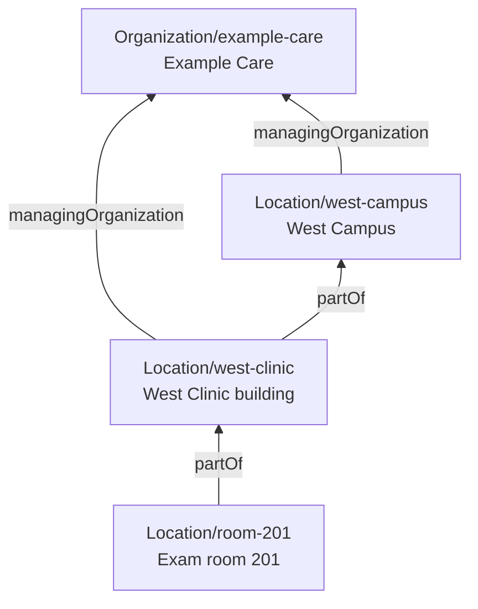
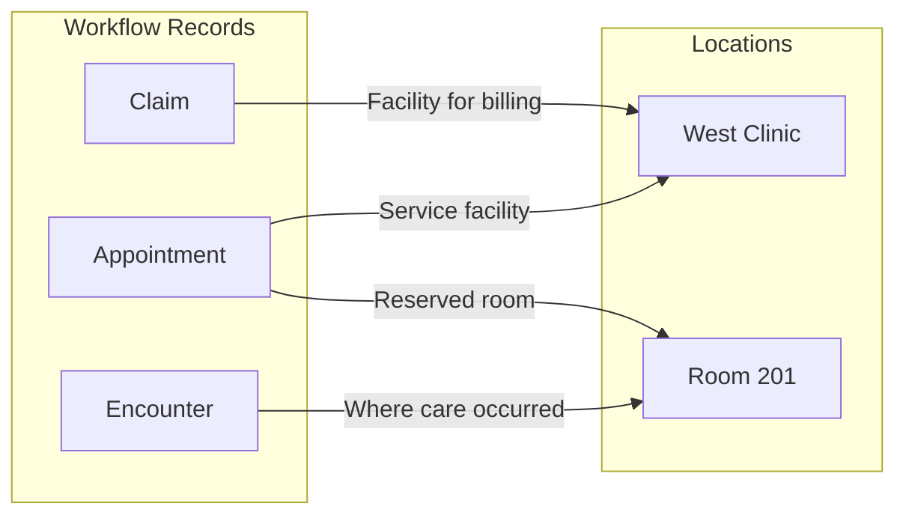

Use this guide to model organizations and the places they use across scheduling, referrals, clinical care, and billing. Connect facilities to the organizations and services that use them, and choose the appropriate reference for each workflow.

A clinic can be the facility selected during booking and reported on a claim, while a room within it is reserved and recorded on the Encounter. These references can point to the same Location when that is sufficient; add detail when the workflow needs it.

## Places, Organizations, and Services

| What you need to represent | Resource and relationship |
| :--- | :--- |
| A practice, business, or operational division | `Organization`; use `Organization.partOf` for an organizational hierarchy. |
| A clinic, campus, building, room, or bed | `Location`; use `Location.partOf` to connect a place to its containing Location. |
| The organization managing a place | `Location.managingOrganization` references the Organization responsible for its provisioning and upkeep. |
| A service offered at one or more places | `HealthcareService.location` references those Locations; `HealthcareService.providedBy` identifies the organization providing the service. |
| A provider's role at an organization or service | `PractitionerRole` connects the practitioner, organization, services, and locations relevant to that role. |

An additional clinic usually needs another Location. Add an Organization when the organizational distinction itself matters, such as a separately managed division, billing entity, or tenant. Multiple Locations can share one managing Organization. See [Modeling Provider Organizations](/docs/administration/provider-directory/provider-organizations) for the broader directory model.

Some integrations use **practice location** to mean an Organization. [Health Gorilla](/docs/integration/health-gorilla/multiple-locations) and [ScriptSure](/docs/integration/scriptsure/multiple-locations) model their practice locations this way. A clinic may need both an integration-specific Organization and a Location for scheduling, clinical care, or billing. Maintain each record according to its integration's mapping, and synchronize shared details through your application or integration workflow.

Use `Organization.partOf` for organizational subdivisions. For relationships between distinct organizations, such as partnerships or network participation, use [OrganizationAffiliation](https://hl7.org/fhir/R4/organizationaffiliation.html). See [Modeling Provider Networks](/docs/administration/provider-directory/provider-networks) for insurance network relationships.

### Organizations and Tenant Boundaries

An Organization describes an entity; a Location describes a place. Neither automatically establishes a tenant boundary. One practice can operate several clinics in a single tenant, while a platform serving independent practices may treat each practice as a tenant. Choose the boundary in the [Tenancy Design Decision Guide](/docs/decision-guides/tenancy-design).

- **Access rules:** `partOf` and `managingOrganization` describe relationships. Enforce permissions through [AccessPolicy and ProjectMembership](/docs/access/access-policies). A tenant can contain finer care-team access groups.
- **Patient information:** Decide whether practices use one common Patient record or independently maintained Patients. Choose access to clinical records separately. [Patient Records and Clinical Sharing](/docs/tenancy-design/patient-records) explains both choices and how patient-wide account assignment can share clinical records.
- **Shared directories:** Organizations can represent payers, pharmacies, laboratories, and networks used by several practices. Keep patient-specific information on appropriately protected records. See [Sharing pharmacy Organizations](/docs/integration/scriptsure/multiple-locations#sharing-pharmacy-organizations).

For within-project boundaries, choose an Organization, HealthcareService, or other resource that represents your access group in [Tenant Assignment and Access](/docs/access/multi-tenant-access-policy). For resource containers and project administration, see [Projects](/docs/access/projects).

## Choose the Location Detail You Need

For a simple outpatient practice, start with one clinic Location. Add detail as the workflow requires:

- **Rooms or beds:** Reserve their capacity or document where care occurred.
- **Campus or building:** Group or identify the places your application uses.

In this example, West Clinic occupies one building on a campus. The clinic is the service facility used for booking and billing, and Room 201 has its own reservable calendar.

Choose the levels that describe your practice. A standalone clinic can be the root Location, and a clinic occupying part of a building can represent just that space. Use `Device.location` to place equipment within the hierarchy.

Populate each Location with the address fields its workflows require. When a query needs to include related places, explicitly follow the relevant `partOf` relationships.

## Describe Each Location

| Field | What it tells consumers |
| :--- | :--- |
| `name`, `address` | The place's identity and address. Populate the fields required by the workflows using that Location. |
| `physicalType` | Physical form, such as a site, building, room, or bed. |
| `type` | Function or service setting. |
| `mode` | `instance` identifies a particular place; `kind` describes a class of places, such as a generic patient's home. Use instances for the specific places in the example. |
| `status` | Whether the Location is active, suspended, or inactive. |
| `partOf` | A reference to the containing Location. |
| `managingOrganization` | The Organization responsible for the Location's provisioning and upkeep. |
| `identifier` | Business identifiers used to match the place across systems. If a billing integration requires a service-facility NPI, record it using `http://hl7.org/fhir/sid/us-npi`. |
| `hoursOfOperation` | Opening hours. Medplum scheduling availability is configured separately through HealthcareService and Schedule scheduling parameters. |

See [FHIR R4 Location fields](https://hl7.org/fhir/R4/location-definitions.html) for the full definitions and [Billing Facility and Place of Service](#billing-facility-and-place-of-service) for claim-specific mappings.

## Choose the Reference for Each Workflow

For one visit at West Clinic, the Appointment and Claim identify the clinic as the facility. The room reservation and Encounter both identify Room 201.

The room reservation uses Slots on the room's Schedule. Your clinical and billing workflows create the Encounter and Claim and set their locations.

| Workflow | Field | Example |
| :--- | :--- | :--- |
| Offer a visit type at the clinic | `HealthcareService.location` | West Clinic. |
| Associate a provider with the clinic | `PractitionerRole.location` | West Clinic, in the relevant role context. |
| Place a device in a room | `Device.location` | Room 201. |
| Identify who should receive a referral or perform an ordered service | `ServiceRequest.performer` | The receiving Organization, HealthcareService, or clinician. |
| Request a physical site for that service | `ServiceRequest.locationReference` | West Clinic. |
| Give the room a reservable calendar | `Schedule.actor` | Room 201. |
| Record the booking's service facility | `Appointment.supportingInformation`, using Medplum's facility marker | West Clinic. |
| Reserve the room for an appointment | `Appointment.participant.actor` and Slots linked to its Schedule | Room 201, included in the booking. |
| Record where the patient received care | `Encounter.location[].location` | Room 201. |
| Identify the facility for a claim | `Claim.facility` | West Clinic, when appropriate for the submission. |

Medplum records the service facility in FHIR's `Appointment.supportingInformation` using a marker defined by `SchedulingSiteURI`. Use `toAppointmentSiteReference` to create the marked reference and `getAppointmentSite` to read it, both from `@medplum/core`.

For referrals and orders, choose the recipient through `ServiceRequest.performer` and specify a requested physical site through `ServiceRequest.locationReference` when needed. See [Recipients and Referral Packages](/docs/careplans/referrals/recipients-and-packages#choose-the-recipient-model) for choosing the destination.

### Scheduling

- **Room reservations:** Reserve room capacity by including the room's Schedule when finding and booking time. Availability is implicit: Medplum creates Slots only for booked, held, or blocked time. See [Defining Availability](/docs/scheduling/defining-availability).

- **Hours by site:** For different hours at each site, use separate HealthcareServices with a shared practitioner Schedule and service-specific overrides where needed. See [Choosing the actor](/docs/scheduling/defining-availability#choosing-the-actor).

- **Time zones:** Set the availability time zone on the Schedule or HealthcareService, with the Schedule actor's time zone as the fallback. To use a facility's time zone for a practitioner, configure it explicitly. See [Facility Time Zones](/docs/scheduling/timezones#facility-time-zones).

- **Closures:** When a facility closes or changes hours, update the affected Schedules or block the unavailable time on each calendar.

- **Licensure:** Use jurisdiction Locations for licensed areas and clinic Locations for facility assignments. Follow the [service-specific licensure model](/docs/scheduling/state-by-state-licensure) when needed, and enforce required eligibility checks in the application's controlled booking path.

[SchedulingConfigWorkspace](https://storybook.medplum.com/?path=/story/medplum-schedulingconfigworkspace--basic) can create its own facility-assignment `PractitionerRole` with `organization` unset, alongside directory roles. The React booking UI combines locations from each provider's active roles; see [Configuration ownership](/docs/scheduling/react-components#configuration-ownership) and [Facility matching](/docs/scheduling/react-components#service-facility-references). Enforce access to the underlying data with AccessPolicy. Choose how to use the UI in the [Scheduling Decision Guide](/docs/decision-guides/scheduling).

### Clinical Care

Use `Encounter.location` at the level the clinical workflow needs. Its entries can include `status` and `period` to distinguish planned locations from actual presence and to record movement during care.

`Encounter.serviceProvider` identifies the organization responsible for the encounter's services. See [FHIR R4 Encounter location](https://hl7.org/fhir/R4/encounter-definitions.html#Encounter.location) and the [Chart Data Model](/docs/charting/chart-data-model).

## Billing Facility and Place of Service

`Claim.facility` identifies the Location where services were provided. A **place-of-service code** classifies the setting for billing. The facility, billing provider, and place-of-service classification are separate inputs.

The claim-building workflow must choose the facility appropriate for the submission and supply its required name, address, and identifiers on that Location. The Candid and Stedi integrations read those details directly from the selected record. Depending on the submission requirements, this may be the clinic containing the encounter room or another relevant facility.

FHIR R4 allows a service line's `Claim.item.location[x]` to be a coded setting, an address, or a Location reference. For Medplum's Candid and Stedi professional-claim integrations, set the place-of-service code explicitly on `Claim.item.locationCodeableConcept`. See [FHIR Claim definitions](https://hl7.org/fhir/R4/claim-definitions.html), [Candid facility mapping](/docs/integration/candid/claim-submission#location-service-facility), and [Stedi facility mapping](/docs/integration/stedi/claim-submission/professional-claims#service-facility) for the applicable requirements and fallback behavior.

## Telehealth

Keep the visit's delivery method separate from where its participants are located. A remote visit still has location information relevant to clinical care, eligibility, and billing.

FHIR R4 describes a virtual encounter using `Encounter.class` and, when useful, an `Encounter.location` reference to a generic setting such as the patient's home. Use `mode = kind` for this shared category, or `mode = instance` for a specific place. Capture the patient's actual location as needed for the visit. See [FHIR R4 virtual encounters](https://hl7.org/fhir/R4/encounter-definitions.html#Encounter.location).

| Question | Workflow consideration |
| :--- | :--- |
| How will the visit happen? | Distinguish in-person, video, and phone visits and provide joining instructions where applicable. |
| Where is the patient during this visit? | Confirm the patient's current setting and jurisdiction when needed for the service, including the address when the care workflow requires it. |
| Where is the clinician working? | Capture the clinician's location during this visit when required. |
| What should billing report? | Derive the required place of service and facility information from the visit context and submission requirements. |

For US professional claims, CMS distinguishes telehealth at home from telehealth elsewhere. Use the [CMS definitions](https://www.cms.gov/medicare/coding-billing/place-of-service-codes/code-sets) and the relevant payer requirements for that classification.

Choose how the application captures and confirms these facts, then maps them into clinical and billing records. Offer a physical facility choice for a virtual visit only when that place is relevant to the workflow.
