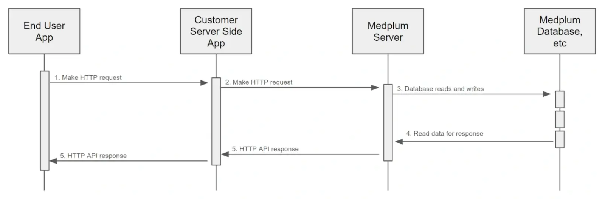

On-Behalf-Of lets your backend use one privileged `ClientApplication` as its machine-to-machine identity and supply a user's membership context for each Medplum request. This is the decision guide's [single machine-to-machine user approach](/docs/decision-guides/authentication#option-c-on-behalf-of-single-machine-to-machine-user). Medplum applies the delegated membership's access policy and records the application and delegated profile on resource writes.

Use this page to implement delegation with an application credential. For a backend using exchanged user credentials, follow [server-held token exchange](/docs/auth/token-exchange#server-held-medplum-tokens).

## Overview

Consider this common Medplum architectural pattern:



Your backend authenticates the person using your application's login system, resolves the corresponding Medplum membership, and attaches that context to outgoing Medplum requests. Derive the delegation header from the verified identity and authorized application context.

## How to Use

### Authenticate the application

Authenticate your backend as a `ClientApplication` with [Project Admin](/docs/access/admin#project-admin) rights. Follow [Client Credentials](/docs/auth/client-credentials) to obtain an application access token. On-Behalf-Of also supports Basic Authentication. Keep these application credentials on the trusted backend.

### Resolve and attach user context

Authenticate the incoming user request and resolve its Medplum membership using a mapping controlled by your backend. Include the `X-Medplum-On-Behalf-Of` header on each outgoing request. The value can be either:

1. A membership reference, `ProjectMembership/{id}`. This explicitly selects the membership stored in your backend's mapping.
2. A profile reference, such as `Patient/{id}` or `Practitioner/{id}`. Medplum looks up the corresponding `ProjectMembership` in the application's project.

For more information on `ProjectMemberships` and profile resources, see the [User Management Guide](/docs/user-management).

Include the header on every delegated request. Medplum resolves the delegation context for that request, and resource versions created or updated under that context retain the delegated profile in `meta.onBehalfOf`.

### Handle missing or invalid context

Without the header, Medplum uses the application's own access. A valid header for a different user can delegate to that user. Reject requests with missing or inconsistent user context before calling Medplum, and do not forward an arbitrary delegation header supplied by the caller.

Treat a rejected delegation request as a failure; do not retry it without the header. Keep privileged application operations separate from handlers serving user requests.

### Lock down the application credential

The On-Behalf-Of model is designed to use individual users' `ProjectMembership`s while authenticating through a single machine-to-machine user. We recommend configuring the `ClientApplication` that serves the proxy layer with a "least permissive" AccessPolicy, including IP access rules:

```json
{
  "resourceType": "AccessPolicy",
  "name": "On-Behalf-Of backend",
  "resource": [],
  "ipAccessRule": [
    { "name": "Backend egress", "value": "203.0.113.10", "action": "allow" },
    { "name": "Block everything else", "value": "*", "action": "block" }
  ]
}
```

- Delegated requests use only the delegated membership's access policy, so this policy doesn't limit what users can do.
- Requests without the header fail closed instead of running with broad application access.
- [IP Access Rules](/docs/access/ip-access-rules) are checked on every `client_credentials` token request and every Basic auth request, so a leaked client secret can't be used from outside your network.

Project Admin access to project administration resources (`ProjectMembership`, `AccessPolicy`, `Project`, etc.) is still granted on top of this policy. IP rules on the delegated user's own policy are not checked on delegated requests.

### Live updates

Do not use On-Behalf-Of for WebSocket subscriptions. Use a user-scoped Medplum token, or deliver updates through a backend that enforces each recipient's resource and field-level access. WebSocket notification authorization does not preserve the HTTP request's delegation context.

## How it Works

When the Medplum Server receives a request with the `X-Medplum-On-Behalf-Of` header, it will:

1. Authenticate the application and check its Project Admin authority.
2. Resolve the header to a `ProjectMembership` and its profile. The membership and its project must be active. Project Admin delegation stays within the application's project. Super admin context can delegate across projects using an explicit `ProjectMembership/{id}` reference; profile references always resolve in the application's project.
3. Apply the delegated membership's access policy and any SMART resource scopes on the application's login.
4. Execute the request. On resource creates and updates, record the application in `meta.author` and the delegated profile reference in `meta.onBehalfOf`. Read responses retain the attribution stored on the resource version.

## Example

Here is a curl example of using the `X-Medplum-On-Behalf-Of` header:



Here is the same example using the Medplum SDK:



For a client dedicated to one delegated membership, you can set the header at construction. Keep that client isolated to the selected user context:



Note the two extra HTTP request headers:

1. `X-Medplum: extended` - This is required to enable the extended Medplum API features, such as `meta.author` and `meta.onBehalfOf`.
2. `X-Medplum-On-Behalf-Of` - A membership reference (`ProjectMembership/{id}`) or profile reference identifying the user context for this request.

Here is the resulting FHIR JSON:

```json
{
  "resourceType": "Patient",
  "id": "00000000-689b-4e20-a3c2-6f55108b432a",
  "meta": {
    "versionId": "00000000-b58b-47c8-9fc0-f85627d333c9",
    "lastUpdated": "2024-07-13T21:18:45.850Z",
    "author": {
      "reference": "ClientApplication/00000000-d361-46f0-adf4-f56da467dc08",
      "display": "My Client"
    },
    "onBehalfOf": {
      "reference": "Practitioner/00000000-9886-4b83-a25a-3b99563b8127",
      "display": "My Test User"
    }
  },
  "name": [{ "given": ["Homer"], "family": "Simpson" }]
}
```
