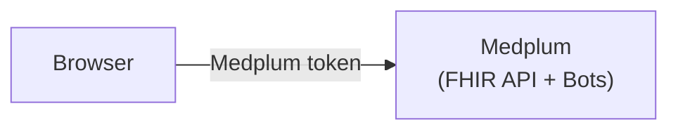
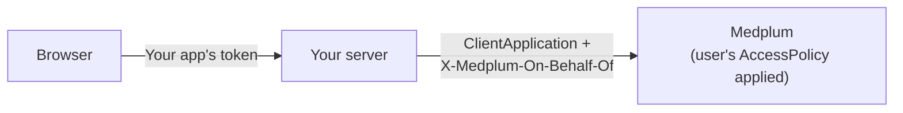

Most apps don't need their own server between users and Medplum. Which pattern you need depends on the token your user has.

## User has a Medplum token: call Medplum directly

Call Medplum directly from the browser or mobile app. For server-side logic, use [Medplum Bots](/docs/bots), which can [run as the calling user](/docs/bots/bot-run-as-user).



Avoid adding your own server here. It adds latency, duplicates auth, and makes privilege escalation easy.

## User has a non-Medplum token: use On-Behalf-Of

Your server verifies your app's token, then calls Medplum as a `ClientApplication` with [On-Behalf-Of](/docs/auth/on-behalf-of) set to the user's `ProjectMembership`.



If your identity provider supports OIDC, consider [token exchange](/docs/auth/token-exchange) instead, so users get a Medplum token.

## Securing your server

Your server is now part of your security boundary.

### Map each user to their own membership

- Verify your app's token on every request.
- **Map each user ONLY to their own `ProjectMembership`, using a mapping stored on your server. Otherwise users can act as each other.**
- Never forward a caller-supplied `X-Medplum-On-Behalf-Of` header.
- **Fail closed:** if user context is missing, reject the request. Never call Medplum without the header.

### Lock down the ClientApplication

On-Behalf-Of requires a Project Admin `ClientApplication`. Give its `ProjectMembership` an AccessPolicy with no data access and an IP allowlist:

```json
{
  "resourceType": "AccessPolicy",
  "name": "Server-to-server client",
  "resource": [],
  "ipAccessRule": [
    { "name": "Server egress", "value": "203.0.113.10", "action": "allow" },
    { "name": "Block everything else", "value": "*", "action": "block" }
  ]
}
```

Keep its secret in a secrets manager, and use a separate `ClientApplication` per environment.

### Configure the client

```ts
const medplum = new MedplumClient({
  baseUrl: 'https://api.medplum.com/projects/YOUR_PROJECT_ID/', // project-scoped URL
  cacheTime: 0, // never share cached responses across users
});
```

### Forward only what you need

- Allowlist routes, methods, and resource types. Reject everything else.
- Block admin resources (`ProjectMembership`, `AccessPolicy`, `ClientApplication`, etc.) and `/auth/`, `/oauth2/`.
- Check batches, `$operations`, and `_history`, not just path prefixes.

### Test it

Verify that a user can't reach another user's or project's data, that requests without auth or delegation are rejected, and that unlisted routes are blocked.

## Related

- [Authentication Decision Guide](/docs/decision-guides/authentication)
- [On-Behalf-Of Delegation](/docs/auth/on-behalf-of)
- [Token Exchange](/docs/auth/token-exchange)
