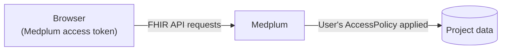
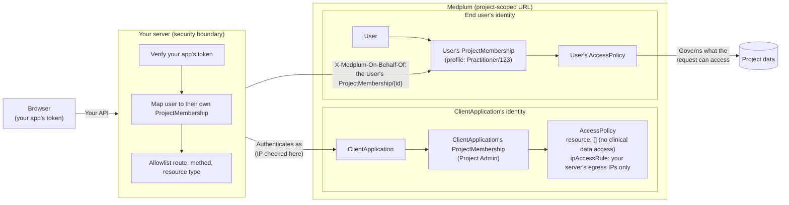
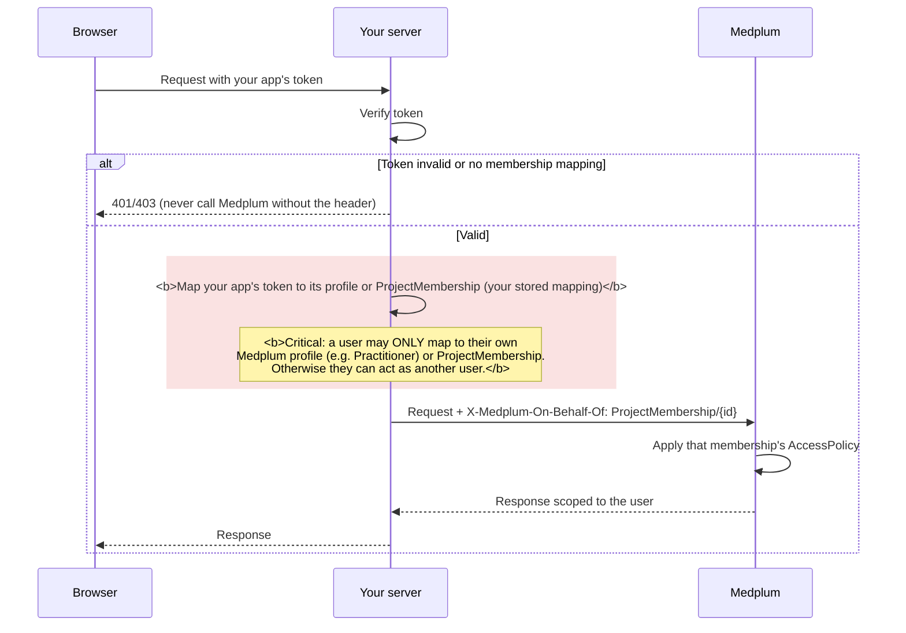

Some applications put their own server between the user and Medplum, calling Medplum from that server on the user's behalf. This server-to-server communication is sometimes necessary, but it makes your server part of your security boundary: it holds credentials, decides which user each request represents, and controls what reaches Medplum.

Medplum enforces authentication, project isolation, and access policies on every request. It cannot verify that your server authenticated the right user or forwarded only what that user should be able to do. Start by deciding whether you need a server in between at all.

## Choose your pattern

The right architecture depends on what token the user has.

### The user has a Medplum token: connect directly

If the user signs in to Medplum (for example, with [Medplum Redirect Login](/docs/auth/medplum-as-idp), [Embedded Login](/docs/auth/embedded-login), or client-held [token exchange](/docs/auth/token-exchange#client-held-medplum-tokens)), the browser or mobile app should call Medplum directly with that token.



This is the recommended pattern. Medplum validates the token and applies the user's own access policy to every request, so there's no privileged server credential to protect and no user mapping to get wrong.

Putting your own server in between a Medplum token and Medplum is not recommended. It adds latency and attack surface without adding any access control Medplum doesn't already enforce. If you need custom server-side logic, run it alongside the direct connection (for example, in a [Bot](/docs/bots)) instead of routing user traffic through it.

### The user has a non-Medplum token: use a server with On-Behalf-Of

If your application has its own authentication and the user never receives a Medplum token, a server in between is justified. Your server verifies your application's token, then calls Medplum as a `ClientApplication` using [On-Behalf-Of](/docs/auth/on-behalf-of) to act as the user. Restrict that `ClientApplication` to your server's egress IPs: add [IP Access Rules](/docs/access/ip-access-rules) to the AccessPolicy on the `ClientApplication`'s `ProjectMembership`. They're checked on every token request.



If your identity provider supports OIDC (or GCIP/Firebase), consider [token exchange](/docs/auth/token-exchange) instead: the user gets a Medplum token, and you can use the direct pattern above.

The rest of this page covers securing the server-to-server pattern.

## Delegate safely with On-Behalf-Of

With On-Behalf-Of, your server decides which user each request represents, so that decision has to be airtight:



- Verify your application's token on every incoming request (signature, issuer, audience, and expiry) before calling Medplum.
- **Map your app's token to a profile or `ProjectMembership` reference, and keep track of these mappings on your server. Make sure each user can ONLY access their own corresponding Medplum profile (e.g. `Practitioner`) or `ProjectMembership`. Failure to do this could allow a user to authenticate with Medplum on behalf of another user.** Never forward an `X-Medplum-On-Behalf-Of` header or membership ID supplied by the caller.
- Set the header explicitly on every delegated request. On a client shared across users, pass it per request rather than as a default header.
- **Fail closed.** A request without the header runs with the application's own access. If user context is missing or invalid, reject the request; never retry it without the header.

### When to resolve the membership

Store the mapping from your user ID to a `ProjectMembership` ID on your server, for example in your user table or by matching an [external ID](/docs/user-management/external-ids). You can look it up once when the session starts or on every request:

| Approach            | Pros                                          | Cons                                                                 |
| :------------------ | :-------------------------------------------- | :------------------------------------------------------------------- |
| Once per session    | One lookup; simple to reason about            | Stale if the user's membership is replaced or reassigned mid-session |
| On every request    | Always reflects the current mapping           | An extra lookup on each request                                      |
| Per request, cached | Fresh within a short TTL with little overhead | Cache invalidation to manage                                         |

Medplum rejects inactive memberships on every On-Behalf-Of request, so revoking a user's membership takes effect immediately whichever approach you choose.

## Configure the client

Use a [project-scoped URL](/docs/access/project-scoped-urls) and disable SDK caching explicitly:

```ts
import { MedplumClient } from '@medplum/core';

const medplum = new MedplumClient({
  baseUrl: 'https://api.medplum.com/projects/YOUR_PROJECT_ID/',
  cacheTime: 0,
});
```

- **Project-scoped URL:** credentials issued for another project are rejected. Get tokens and make requests through the same base URL, since project-scoped tokens are bound to it.
- **`cacheTime: 0`:** `MedplumClient` caches reads by default in browser-like environments, detected by whether `window` is defined. Server runtimes don't always detect cleanly, so set it explicitly. A client shared across users must never return one user's cached response to another. Make sure your framework, HTTP layer, and CDN don't cache authenticated responses either.

## Treat every request as untrusted

Assume attackers will call your server directly, with arbitrary paths, query parameters, headers, and methods, not just what your UI sends.

- Don't let user input choose the upstream URL, project, credential, or authentication context.
- Don't blindly forward `Authorization`, `X-Medplum-On-Behalf-Of`, or other security-sensitive headers.
- Apply the same authorization checks across every route and HTTP method.

## Test from an attacker's perspective

Include these cases in automated integration tests, and supplement them with periodic security reviews or penetration testing:

| Scenario               | Verify that                                                           |
| :--------------------- | :-------------------------------------------------------------------- |
| Cross-project access   | Tokens or identities from another project can't reach your data       |
| Cross-user access      | One user can't read or write another user's data                      |
| Missing authentication | Unauthenticated requests are rejected                                 |
| Missing delegation     | Requests never fall back to the application's own permissions         |
| Unexpected routes      | Unlisted resources, admin resources, and auth endpoints are rejected  |
| Concurrent sessions    | Simultaneous users never share delegation context or cached responses |
| Credential exposure    | Secrets and tokens never appear in responses, logs, or error messages |

## Lock down the ClientApplication

Your server's `ClientApplication` is a privileged machine identity. On-Behalf-Of requires it to be a Project Admin, so restrict it in every other way:

- **Permissionless access policy:** give its `ProjectMembership` an AccessPolicy with no clinical data access (`"resource": []`). Delegated requests use only the delegated user's access policy, so this doesn't limit your users, and a request that's missing the On-Behalf-Of header can't read or write clinical data. See [Lock down the application credential](/docs/auth/on-behalf-of#lock-down-the-application-credential).
- **IP restrictions:** add [IP Access Rules](/docs/access/ip-access-rules) to that policy allowing only your servers' egress IPs, followed by a wildcard block. They're checked on every `client_credentials` token request and every Basic auth request.
- **Secret storage:** keep client secrets in a secrets manager, never in browser bundles, repositories, or logs.
- **Separate environments:** use different `ClientApplication`s for development, staging, and production.
- **Stronger authentication:** consider [Mutual TLS](/docs/auth/mtls) or [Client Assertion](/docs/auth/client-assertion) instead of a shared secret.

Example policy:

```json
{
  "resourceType": "AccessPolicy",
  "name": "Server-to-server client",
  "resource": [],
  "ipAccessRule": [
    { "name": "Server egress", "value": "203.0.113.10", "action": "allow" },
    { "name": "Block everything else", "value": "*", "action": "block" }
  ]
}
```

## Forward only what you need

Don't blindly forward every endpoint through to the Medplum server. Allowlist only the specific routes, HTTP methods, and resource types your application uses, and reject everything else. Many applications only need part of `/fhir/R4/`.

- Keep administrative resources (`Project`, `ProjectMembership`, `AccessPolicy`, `ClientApplication`, etc.) out unless explicitly required. Your `ClientApplication` is a Project Admin, so these are reachable through it.
- Don't forward `/auth/` or `/oauth2/` unless your application needs them. If it does, allow only the specific operations required.
- Validate the effective operation, not just a path prefix. FHIR requests include searches, `$operations`, `_history`, and batch/transaction bundles that can reach other resource types.

## Related

- [Authentication Decision Guide](/docs/decision-guides/authentication)
- [On-Behalf-Of Delegation](/docs/auth/on-behalf-of)
- [Token Exchange](/docs/auth/token-exchange)
- [Project-Scoped URLs](/docs/access/project-scoped-urls)
- [Access Policies](/docs/access/access-policies)
