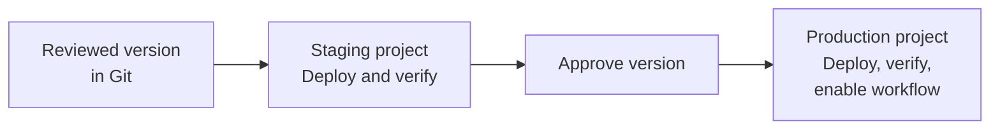
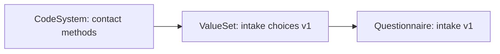

An application's behavior depends on the resources it uses: a Questionnaire defines an intake form, a ValueSet supplies its choices, and a Subscription starts processing the response. Deploy these resources through the same review and testing process as your application code.

This guide uses **staging and production Medplum projects**. Paid hosted plans include staging and production environments; see [pricing](/pricing). Staging is where you verify configuration before applying it to production.

A **configuration version** is a reviewed set of application resources and their dependencies, identified by a Git commit or tag. A **configuration deployment** applies that set to a target project. Medplum server releases have their own version numbers and [upgrade procedure](/docs/self-hosting/upgrading-server).

You will learn how to:

- Keep configuration in source control and separate environment-specific settings.
- Deploy dependencies in order and repeat a deployment safely.
- Verify behavior before enabling the new workflow.
- Preserve older definitions and recover from a failed deployment.



## Decide what to deploy

Keep a small inventory of the resources your application owns, their dependencies, and who reviews changes. Start with one workflow, such as intake, and expand the inventory as you automate more of the application.

| Configuration            | What belongs in source control                                           | What to check in each project                                                   |
| ------------------------ | ------------------------------------------------------------------------ | ------------------------------------------------------------------------------- |
| Questionnaires and plans | `Questionnaire`, `PlanDefinition`, and `ActivityDefinition` definitions  | Forms, terminology, extraction, and Bots used by the workflow                   |
| Profiles                 | FSH source or `StructureDefinition` JSON, plus pinned dependencies       | Base profiles, terminology, and the resources the new constraints will affect   |
| Terminology              | Application-owned `CodeSystem`, `ValueSet`, and `ConceptMap` definitions | Required standard terminology is available and licensed where applicable        |
| Access policies          | Policy definitions and the intended roles                                | Local references and the memberships or project settings that apply each policy |
| Subscriptions and Bots   | Subscription templates, Bot source, and deployment settings              | Local Bot IDs, endpoints, secrets, permissions, and activation order            |

Store the **environment-specific values** separately: project IDs, Bot IDs, service URLs, and references to locally provisioned organizations or users. Inject secrets through your CI secret store or [Project Secrets](/docs/bots/bot-secrets). Patient records and completed responses stay in their originating environment.

If you author a form in the Medplum App, export that selected definition, review the JSON, and commit it before deployment. Remove source-project IDs and server-managed metadata; retain authored fields such as `meta.profile`. Include referenced definitions or document them as prerequisites. A whole-project export can include patient data, users, and unrelated settings; use an explicit configuration inventory.

## Set up the two deployment targets

Create a [ClientApplication](/docs/auth/client-credentials) in each project for deployment. Its [AccessPolicy](/docs/access/access-policies) must allow reading and writing the configuration types it manages. Policy assignment and project-setting changes may require a separately authorized administrator.

For each environment, configure:

| Variable                | Staging                    | Production                   |
| ----------------------- | -------------------------- | ---------------------------- |
| `MEDPLUM_BASE_URL`      | `https://api.medplum.com/` | `https://api.medplum.com/`   |
| `MEDPLUM_PROJECT_ID`    | Staging project ID         | Production project ID        |
| `MEDPLUM_CLIENT_ID`     | Staging deployment client  | Production deployment client |
| `MEDPLUM_CLIENT_SECRET` | Staging secret             | Production secret            |

Use the server's base URL, without `/fhir/R4`. The SDK constructs the FHIR URLs. The project ID is a guard against using the wrong credentials; setting that variable does not switch the authenticated project.

Run one configuration deployment at a time per project. Keep production approval and credentials in your production CI environment.

## Keep identities consistent across projects

The same definition normally has different resource IDs in staging and production. Use stable identities to locate it in each project:

| Field            | Purpose                                               | Example                                                       |
| ---------------- | ----------------------------------------------------- | ------------------------------------------------------------- |
| `identifier`     | Find the definition during deployment                 | System `https://example.com/configuration`, value `intake-v1` |
| `url`            | Canonical identity used by supporting FHIR fields     | `https://example.com/fhir/Questionnaire/intake-v1`            |
| `version`        | Business version of a definition                      | `1.0.0`                                                       |
| `id`             | Address this project's stored resource                | `Questionnaire/<local-id>`                                    |
| `meta.versionId` | Server revision for history and write-conflict checks | Returned by Medplum when the resource is saved                |

Keep identifiers and canonical URLs consistent across environments. Resolve ordinary references, such as `Bot/<id>` or a policy's organization reference, to resources in the target project. Preserve the returned IDs in the deployment record. Canonical URLs identify definitions; they do not need to point to the project's API hostname.

**A business version does not freeze a resource.** Updating the same resource ID changes what an ordinary reference reads. Publish a new definition when existing responses or running workflows must retain the old behavior. Follow the [profile update guidance](/docs/fhir-datastore/profiles#updating-profiles) for changes to validation rules.



Medplum's current ValueSet expansion removes the `|version` suffix before looking up the canonical URL. Do not rely on `url|version` alone to select historical answer choices. The example below uses a distinct ValueSet URL for each published revision and keeps the earlier resource available.



## Deploy a small intake configuration

This example publishes three definitions in dependency order:



The form asks how a patient prefers to be contacted, with **Email** and **Phone** as choices. These are example application codes in an example namespace. Replace that namespace with one your organization owns.

### 1. Save the definitions and deployment script

Copy these two files into a `configuration/` directory in your application repository. Install `@medplum/core`, `@medplum/fhirtypes`, and the `tsx` development dependency if your project does not already have them. Commit your package lockfile along with the configuration.

| File                      | Purpose                                                      |
| ------------------------- | ------------------------------------------------------------ |
| `intake-configuration.ts` | Definitions, target check, preview, and deployment functions |
| `deploy-intake.ts`        | Authenticates and runs either `preview` or `apply`           |

<details>
<summary>intake-configuration.ts: definitions and deployment functions</summary>





</details>

<details>
<summary>deploy-intake.ts: command entry point</summary>



</details>

The deployment function uses **conditional create** for these published definitions. A repeat run reuses an identical definition. If an existing definition has different content, the script stops so you can review the difference. The preview and comparison are application code supplied by this example.

The write itself is conditional on the identifier and the target project compartment. This excludes linked reference projects from matching and lets Medplum check existence at write time. Definitions are saved sequentially, so a failed prerequisite prevents its dependents from being submitted.

Preview also stops if another visible resource already uses the canonical URL. Reconcile existing resources before adopting the script. If a linked project supplies a dependency, record it as a prerequisite and omit it from the local deployment list.

### 2. Preview and apply to staging

Load the four staging variables from your environment configuration, then run:

```bash
npx tsx configuration/deploy-intake.ts preview
npx tsx configuration/deploy-intake.ts apply
```

On the first preview, expect three `create` actions. Apply returns the local reference for each identifier, including `intake-v1: Questionnaire/<staging-id>`. Running preview again should report three `unchanged` actions. Reapplying the same content reuses the same resources.

The preview performs reads and detects duplicates or changed published definitions. It does not exercise server write validation or reserve resources. Apply checks the returned definitions again, and any error stops the command with a nonzero exit code.

### 3. Verify the workflow in staging

Use synthetic patient data and the same user roles your application uses in production:

- Open the returned Questionnaire in your application or the [Medplum App form view](/docs/questionnaires/questionnaires-and-responses). Confirm that **Email** and **Phone** load from the ValueSet.
- Save a response and reopen it. Confirm that the response identifies the intended Questionnaire and retains its answer.
- Exercise any [extraction or Bot processing](/docs/questionnaires/parsing-questionnaire-responses) your application adds, and inspect its outputs.
- Verify that the intended users can use the configuration and that other roles cannot perform restricted actions. A successful deployment-client request does not test end-user access.

For other configuration types, add focused checks:

| Change         | Verification before activation                                                                                                                                                                                                  |
| -------------- | ------------------------------------------------------------------------------------------------------------------------------------------------------------------------------------------------------------------------------- |
| Profile        | Validate representative conforming and invalid resources against the profile. For `Project.defaultProfile`, create a test resource without `meta.profile` and inspect its stored profile; `$validate` checks explicit profiles. |
| Terminology    | Run the lookup, expansion, or translation the application actually uses, and check expected results.                                                                                                                            |
| AccessPolicy   | Test allowed and denied requests using the affected membership. Uploading a policy alone does not assign it.                                                                                                                    |
| PlanDefinition | Start the workflow with test data and verify its generated tasks, forms, or requests.                                                                                                                                           |
| Subscription   | Trigger the intended transition once and inspect delivery or Bot output, including duplicate-event handling.                                                                                                                    |

### 4. Apply the approved version to production

Record the Git commit or tag that passed staging. Use those exact files and dependency versions for production, load the production variables, and run the same preview and apply commands. Keep production's returned resource references with the deployment record.

**Choose an explicit activation step.** The example saves definitions; your application chooses when to start assigning the new Questionnaire. Point new assignments at the returned production Questionnaire reference after verification. Retain older definitions for existing responses and in-progress work. If your application automatically selects active forms, adjust that selection logic before publishing another form. Changes to configuration already in use, such as an assigned policy, can take effect as soon as they are saved.

For automation, [deploy the Bot code](/docs/bots/bots-in-production), configure its permissions and secrets, and resolve its local ID before enabling a new Subscription. Stage a new Subscription with `status: off`, then activate it after its dependencies are ready. Existing workflows need a planned transition: disabling a Subscription misses events during that interval, and reactivation does not automatically replay them.

## Extend the pattern to other configuration

Choose the write behavior for each resource in your inventory:

- **Published definitions that must remain reproducible:** create a new identity for a changed definition. Retain old definitions while records or workflows depend on them. The example follows this pattern.
- **Mutable configuration wholly owned by the deployment:** use [identifier-based conditional upserts](/docs/fhir-datastore/updating-data#upsert-operation). An upsert replaces the resource body, so include all fields the deployment owns and review any environment differences first.
- **Shared or administrator-maintained settings:** read the current resource, change only the intended fields, and use [version checking](/docs/fhir-datastore/updating-data#preventing-lost-updates-with-version-checking). Stop and review a conflict before retrying.

Not every FHIR resource has an `identifier` field. For example, an R4 Subscription needs a separately managed local ID or another supported lookup strategy. Check each resource's schema and search parameters before generalizing the example.

For larger inventories, group independent writes into [batch requests](/docs/fhir-datastore/fhir-batch-requests). Check **every entry's result**, then submit the next dependency group. General atomic transaction Bundles are unavailable on hosted Medplum, so design for partial completion. The deployment script should record successful writes and failed operations and make a retry safe.

Treat large terminology imports as separate prerequisites when they need their own loading process. Wait for import completion and verify the terminology operations before activating dependent forms or profiles.

## Handle changes and failures

To publish a revised intake form, give it a new identifier, canonical URL, and business version, such as `intake-v2`, `https://example.com/fhir/Questionnaire/intake-v2`, and `2.0.0`. Keep unchanged dependencies at their existing identities. If the answer choices change, publish a new ValueSet URL and point the new form at it. Test both a new response and an older in-progress response before changing which form the application assigns.

Keep a deployment record containing the configuration commit, target server and project, resolved resource IDs, verification results, and activation steps. Preview again before each deployment to identify manual edits or unexpected differences.

| Situation                                    | Next step                                                                                                                                                                      |
| -------------------------------------------- | ------------------------------------------------------------------------------------------------------------------------------------------------------------------------------ |
| A dependency fails halfway through           | Keep the workflow on its previous configuration. Inspect the error and retry the same reviewed configuration after fixing the cause. Successful writes remain saved.           |
| Preview finds a changed published definition | Review the server change against Git. Recover the intended definition or publish a new revision; avoid silently overwriting the difference.                                    |
| More than one resource matches an identifier | Investigate the duplicates and their references before proceeding. Do not select an arbitrary match.                                                                           |
| Verification fails after activation          | Stop new assignments to the affected version and restore the previous application selection or compatible settings. Review work already processed under the new configuration. |
| A definition is removed from the repository  | Retire it explicitly after checking its consumers. Removing a file should not automatically delete historical definitions.                                                     |

**Redeploying old configuration does not undo patient data changes or external side effects.** Use a separate migration or recovery procedure for responses, tasks, notifications, or external requests already produced. Test compatibility between the previous configuration and the currently deployed application before reverting.

## When environments use separate Medplum instances

The same workflow applies when staging and production have different servers. Give each target its own base URL, credentials, and project IDs. Confirm that both instances support the required Medplum version, project features, terminology, and Bot runtime before deployment.

If projects represent customers within each instance, deploy shared definitions into that instance's reference projects and use [project linking](/docs/access/projects#project-linking) to expose the required resource types. Keep staging and production reference content separate. Project provisioning and linking require super-admin access; routine content writes should use the appropriate project credentials.

Configure new customer projects with the required links. When introducing another reference project, also backfill its link into existing customer projects. Updating content in an already linked reference project uses the existing links. Keep tenant-specific policies, settings, and automation in the deployment inventory, and verify from a representative tenant.
