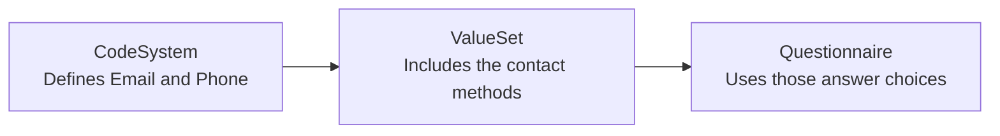
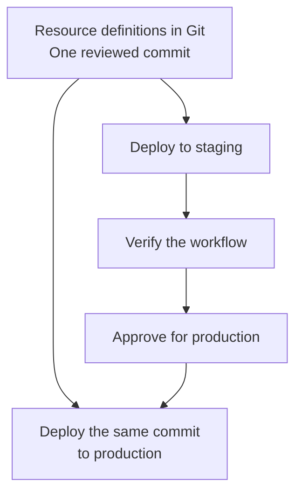

Once your intake form works in staging, you need a reliable way to deploy it to production, including the answer choices and other definitions it depends on.

By keeping these resources in source control, you can review their changes alongside your application code and deploy the same reviewed definitions to each environment.

This guide walks through a contact-preference form built from a Questionnaire, ValueSet, and CodeSystem. You'll preview and deploy those resources to staging, verify the form, and deploy the same source-controlled version to production. Patient records and completed responses stay in their original environment.

You can also adapt this approach to profiles, policies, plans, and Subscriptions. [Later sections](#apply-the-pattern-to-other-resources) explain the identity, update, and verification choices for each.

## What are we deploying?

A **resource definition** is the authored content you keep in your repository, such as a form's questions or its answer choices. A **deployment** applies a reviewed set of those definitions to a target Medplum project.

Start with a small example: a form that asks **How would you prefer to be contacted?**, with **Email** and **Phone** as choices. It uses three resources, deployed in dependency order:



The codes are example application codes, not standard clinical terminology. The definitions use an example namespace; replace it with one your organization owns.

The example's deployment script publishes these three definitions and preserves them on subsequent runs. It does not copy a project, deploy your application code, or decide when your application starts using the form. You'll make that last choice after verification.

## Prepare your repository and environments

You'll need an application repository with a Node.js and npm setup, plus **staging and production Medplum projects**. Paid hosted plans include staging and production environments; see [pricing](/pricing). Use staging and synthetic patient data to test the workflow before deploying to production.

### Save the definitions and script

Copy these two files into a `configuration/` directory in your application repository. Install `@medplum/core`, `@medplum/fhirtypes`, and the `tsx` development dependency if your project does not already have them. Commit your package lockfile along with the resource definitions.

| File | Purpose |
| --- | --- |
| `intake-configuration.ts` | Resource definitions, target check, preview, and deployment functions |
| `deploy-intake.ts` | Authenticates and runs either `preview` or `apply` |

<details>
<summary>intake-configuration.ts: definitions and deployment functions</summary>





</details>

<details>
<summary>deploy-intake.ts: command entry point</summary>



</details>

If you already authored a form in the Medplum App, export that selected definition, review the JSON, and commit it before adapting the example. Remove source-project IDs and server-managed metadata; retain authored fields such as `meta.profile`. Include referenced definitions or document them as prerequisites. A whole-project export can include patient data, users, and unrelated settings; keep an explicit list of the resources you intend to deploy.

### Keep environment settings separate

Create a project-scoped [ClientApplication](/docs/auth/client-credentials) in each project for deployment. Its [AccessPolicy](/docs/access/access-policies) must allow reading and writing the resource types it manages. The example rejects super-admin sessions to keep deployment within the target project. Policy assignment and project-setting changes may require a separately authorized administrator.

Configure these values for each environment:

| Variable | Staging | Production |
| --- | --- | --- |
| `MEDPLUM_BASE_URL` | `https://api.medplum.com/` | `https://api.medplum.com/` |
| `MEDPLUM_PROJECT_ID` | Staging project ID | Production project ID |
| `MEDPLUM_CLIENT_ID` | Staging deployment client | Production deployment client |
| `MEDPLUM_CLIENT_SECRET` | Staging secret | Production secret |

Use the server's base URL, without `/fhir/R4`. The SDK constructs the FHIR URLs. The project ID is a guard against using the wrong credentials; setting that variable does not switch the authenticated project.

Keep project IDs, Bot IDs, service URLs, and references to locally provisioned organizations or users separate from the shared definitions. Inject secrets through your CI secret store or [Project Secrets](/docs/bots/bot-secrets), not committed resource files. Keep production approval and credentials in your production CI environment, and run one deployment at a time per project.

### Give each definition a stable identity

Your repository describes the same form for both environments, but each project stores its own resource. For the example Questionnaire, the identities look like this after deployment. The local IDs below are illustrative, not values to copy:

| Field | Staging | Production |
| --- | --- | --- |
| `identifier` | System `https://example.com/configuration`, value `intake-v1` | Same system and value |
| `url` | `https://example.com/fhir/Questionnaire/intake-v1` | Same canonical URL |
| `version` | `1.0.0` | `1.0.0` |
| `id` | `staging-form-id` | `production-form-id` |
| Resource reference | `Questionnaire/staging-form-id` | `Questionnaire/production-form-id` |

The script uses `identifier` to find the definition during deployment. The canonical `url` lets supporting FHIR fields identify the definition without using a project-local ID; it does not need to point to your API hostname. The authored `version` is a business version, separate from the server-managed `meta.versionId` used for resource history and write-conflict checks.

Keep identifiers and canonical URLs consistent across environments. Resolve ordinary references, such as `Bot/<id>` or a policy's organization reference, to resources in the target project. Preserve the returned IDs in your deployment record.

## Preview and deploy to staging

Load the four staging environment variables, then preview the deployment:

```bash
npx tsx configuration/deploy-intake.ts preview
```

For a project without these definitions, expect the following actions. This is an illustration of the preview result, not a captured terminal session:

```text
resourceType    identifier                  action
CodeSystem      contact-methods-v1          create
ValueSet        intake-contact-choices-v1   create
Questionnaire   intake-v1                   create
```

Check the printed target server and project, then apply:

```bash
npx tsx configuration/deploy-intake.ts apply
```

Apply returns the local reference for each identifier, including `intake-v1: Questionnaire/<staging-id>`. Save these references for verification.

Run preview again with the same files. All three actions should now be `unchanged`. Reapplying the same content reuses the same resources. If you edit an already-published definition without giving it a new identity, preview stops with `Published definition differs` rather than overwriting it. The [revision example below](#change-the-form-without-breaking-existing-responses) shows how to publish a change.

### What the script checks

The preview and comparison are application code supplied by this example, not a built-in Medplum deployment command. Preview performs reads and detects duplicates or changed published definitions. It does not exercise server write validation or reserve resources.

The deployment function uses **conditional create**: Medplum checks for an existing resource at write time, using the identifier and target project compartment. This excludes linked reference projects from matching the write. Apply checks the returned definitions again, and any error stops the command with a nonzero exit code.

Definitions are saved sequentially, so a failed prerequisite prevents its dependents from being submitted. Earlier successful writes remain saved; the deployment is not all-or-nothing.

Preview also stops if another visible resource already uses the canonical URL. Reconcile existing resources before adopting the script. If a linked project supplies a dependency, record it as a prerequisite and omit it from the local deployment list.

## Check that the form works

Use synthetic patient data and the same user roles your application uses in production:

1. Open the returned Questionnaire in your application or the [Medplum App form view](/docs/questionnaires/questionnaires-and-responses). Confirm that **Email** and **Phone** load from the ValueSet.
2. Choose an answer, save a response, and reopen it. Confirm that the response identifies the intended Questionnaire and retains its answer.
3. Exercise any [extraction or Bot processing](/docs/questionnaires/parsing-questionnaire-responses) your application adds, and inspect its outputs. The example itself only deploys the definitions.
4. Verify that the intended users can use the form and that other roles cannot perform restricted actions. A successful deployment-client request does not test end-user access.

## Deploy the same version to production

Once staging verification passes, record the Git commit or tag. Deploy those exact files and dependency versions to production:



Load the production environment variables and run the same commands:

```bash
npx tsx configuration/deploy-intake.ts preview
npx tsx configuration/deploy-intake.ts apply
```

Review the production target and preview before applying. Keep production's returned resource references with the deployment record, and verify the deployed form before directing live work to it.

### Choose when the application starts using the form

Deploying the definitions and activating the workflow are separate decisions. Point new assignments at the returned **production** Questionnaire reference after verification. Retain older definitions for existing responses and in-progress work.

The example publishes resources with `status: active`. If your application automatically selects active forms, adjust that selection logic **before** deployment so publishing another form does not switch live work unexpectedly. Other changes, such as updating an assigned policy, can take effect as soon as they are saved.

A Git commit or tag identifies the set of resource definitions you deployed. It is separate from individual definitions' business versions and from Medplum server releases, which have their own version numbers and [upgrade procedure](/docs/self-hosting/upgrading-server).

## Change the form without breaking existing responses

Suppose you want to make the contact-preference question more specific while keeping the same answer choices. Publish a new form instead of overwriting `intake-v1`.

In `intake-configuration.ts`, update the `intake` definition as follows. Keep its other fields and the two terminology definitions unchanged:

| Field | Published form | Revised form |
| --- | --- | --- |
| `identifier[0].value` | `intake-v1` | `intake-v2` |
| `url` | `https://example.com/fhir/Questionnaire/intake-v1` | `https://example.com/fhir/Questionnaire/intake-v2` |
| `version` | `1.0.0` | `2.0.0` |
| `item[0].text` | `How would you prefer to be contacted?` | `How would you prefer our care team to contact you?` |

Commit the change and preview it in staging. Expect `unchanged` for the CodeSystem and ValueSet, and `create` for `intake-v2`. After applying, the earlier `intake-v1` form remains available; the script does not delete definitions removed from its deployment list.

Test both a new response and an older in-progress response. Then deploy the reviewed commit to production and update new assignments to use the returned `intake-v2` reference. Existing responses and assignments should continue to reference the earlier form.

**Changing `version` alone does not freeze or preserve a resource.** Updating the same resource ID changes what an ordinary reference reads. This example uses a new identifier and canonical URL as well as a business version so it can publish a separate resource.

### When the answer choices change

Update the dependencies according to the change:

- **Form-only changes:** keep unchanged terminology at its existing identities, as above.
- **Changed answer choices:** publish a new ValueSet identity and point the new form at its URL.
- **Added or changed codes:** also publish a new application-owned CodeSystem identity, such as `contact-methods-v2` with URL `https://example.com/fhir/CodeSystem/contact-methods-v2` and version `2.0.0`. Point the new ValueSet's `compose.include.system` at that URL, then deploy the CodeSystem, ValueSet, and Questionnaire in order.



Medplum's current ValueSet expansion removes the `|version` suffix before looking up the canonical URL. Do not rely on `url|version` alone to select historical answer choices. This example uses distinct URLs for published revisions of both its ValueSet and its application-owned CodeSystem. Keep both resources unchanged so older forms retain their original choices.



A new CodeSystem URL also changes the `Coding.system` stored in answers. Keep the earlier terminology available and ensure downstream processing can handle answers from both versions. This pattern is for application-owned codes; preserve the publisher's canonical identities when using standard terminology.

### Recover from a failed deployment

Keep a deployment record containing the Git commit, target server and project, resolved resource IDs, verification results, and activation steps. Preview again before each deployment to identify manual edits or unexpected differences.

| Situation | Next step |
| --- | --- |
| A dependency fails halfway through | Keep the workflow on its previous definitions. Inspect the error and retry the same reviewed deployment after fixing the cause. Successful writes remain saved. |
| Preview finds a changed published definition | Review the server change against Git. Recover the intended definition or publish a new revision; avoid silently overwriting the difference. |
| More than one resource matches an identifier | Investigate the duplicates and their references before proceeding. Do not select an arbitrary match. |
| Verification fails after activation | Stop new assignments to the affected version and restore the previous application selection or compatible settings. Review work already processed under the new definitions. |
| A definition is removed from the repository | Retire it explicitly after checking its consumers. Removing a file should not automatically delete historical definitions. |

**Redeploying earlier definitions does not undo patient data changes or external side effects.** Use a separate migration or recovery procedure for responses, tasks, notifications, or external requests already produced. Test compatibility between the previous definitions and the currently deployed application before reverting.

## Apply the pattern to other resources

Once the intake deployment works, expand the inventory of resources your application owns. Record their dependencies and who reviews changes:

| Resources | What belongs in source control | What to check in each project |
| --- | --- | --- |
| Questionnaires and plans | `Questionnaire`, `PlanDefinition`, and `ActivityDefinition` definitions | Forms, terminology, extraction, and Bots used by the workflow |
| Profiles | FSH source or `StructureDefinition` JSON, plus pinned dependencies | Base profiles, terminology, and the resources the new constraints will affect |
| Terminology | Application-owned `CodeSystem`, `ValueSet`, and `ConceptMap` definitions | Required standard terminology is available and licensed where applicable |
| Access policies | Policy definitions and the intended roles | Local references and the memberships or project settings that apply each policy |
| Subscriptions and Bots | Subscription templates, Bot source, and deployment settings | Local Bot IDs, endpoints, secrets, permissions, and activation order |

The supplied script handles CodeSystem, ValueSet, and Questionnaire definitions. Other resource types need their own identity, write, and verification choices; they are not additional inputs you can pass to the example unchanged.

### Choose how each resource is written

- **Published definitions that must remain reproducible:** create a new identity for a changed definition. Retain old definitions while records or workflows depend on them. The example follows this pattern.
- **Mutable configuration wholly owned by the deployment:** use [identifier-based conditional upserts](/docs/fhir-datastore/updating-data#upsert-operation). An upsert replaces the resource body, so include all fields the deployment owns and review any environment differences first.
- **Shared or administrator-maintained settings:** read the current resource, change only the intended fields, and use [version checking](/docs/fhir-datastore/updating-data#preventing-lost-updates-with-version-checking). Stop and review a conflict before retrying.

Not every FHIR resource has an `identifier` field. For example, an R4 Subscription needs a separately managed local ID or another supported lookup strategy. Check each resource's schema and search parameters before generalizing the example. Follow the [profile update guidance](/docs/fhir-datastore/profiles#updating-profiles) for changes to validation rules.

For larger inventories, group independent writes into [batch requests](/docs/fhir-datastore/fhir-batch-requests). Check **every entry's result**, then submit the next dependency group. General atomic transaction Bundles are unavailable on hosted Medplum, so design for partial completion. The deployment script should record successful writes and failed operations and make a retry safe.

Treat large terminology imports as separate prerequisites when they need their own loading process. Wait for import completion and verify the terminology operations before activating dependent forms or profiles.

### Verify behavior before activation

| Change | Verification before activation |
| --- | --- |
| Profile | Validate representative conforming and invalid resources against the profile. For `Project.defaultProfile`, create a test resource without `meta.profile` and inspect its stored profile; `$validate` checks explicit profiles. |
| Terminology | Run the lookup, expansion, or translation the application actually uses, and check expected results. |
| AccessPolicy | Test allowed and denied requests using the affected membership. Uploading a policy alone does not assign it. |
| PlanDefinition | Start the workflow with test data and verify its generated tasks, forms, or requests. |
| Subscription | Trigger the intended transition once and inspect delivery or Bot output, including duplicate-event handling. |

For automation, [deploy the Bot code](/docs/bots/bots-in-production), configure its permissions and secrets, and resolve its local ID before enabling a new Subscription. Stage a new Subscription with `status: off`, then activate it after its dependencies are ready. Existing workflows need a planned transition: disabling a Subscription misses events during that interval, and reactivation does not automatically replay them.

### When environments use separate Medplum instances

The same workflow applies when staging and production have different servers. Give each target its own base URL, credentials, and project IDs. Confirm that both instances support the required Medplum version, project features, terminology, and Bot runtime before deployment.

If projects represent customers within each instance, deploy shared definitions into that instance's reference projects and use [project linking](/docs/access/projects#project-linking) to expose the required resource types. Keep staging and production reference content separate. Project provisioning and linking require super-admin access; routine content writes should use the appropriate project credentials.

Configure new customer projects with the required links. When introducing another reference project, also backfill its link into existing customer projects. Updating content in an already linked reference project uses the existing links. Keep tenant-specific policies, settings, and automation in the deployment inventory, and verify from a representative tenant.
