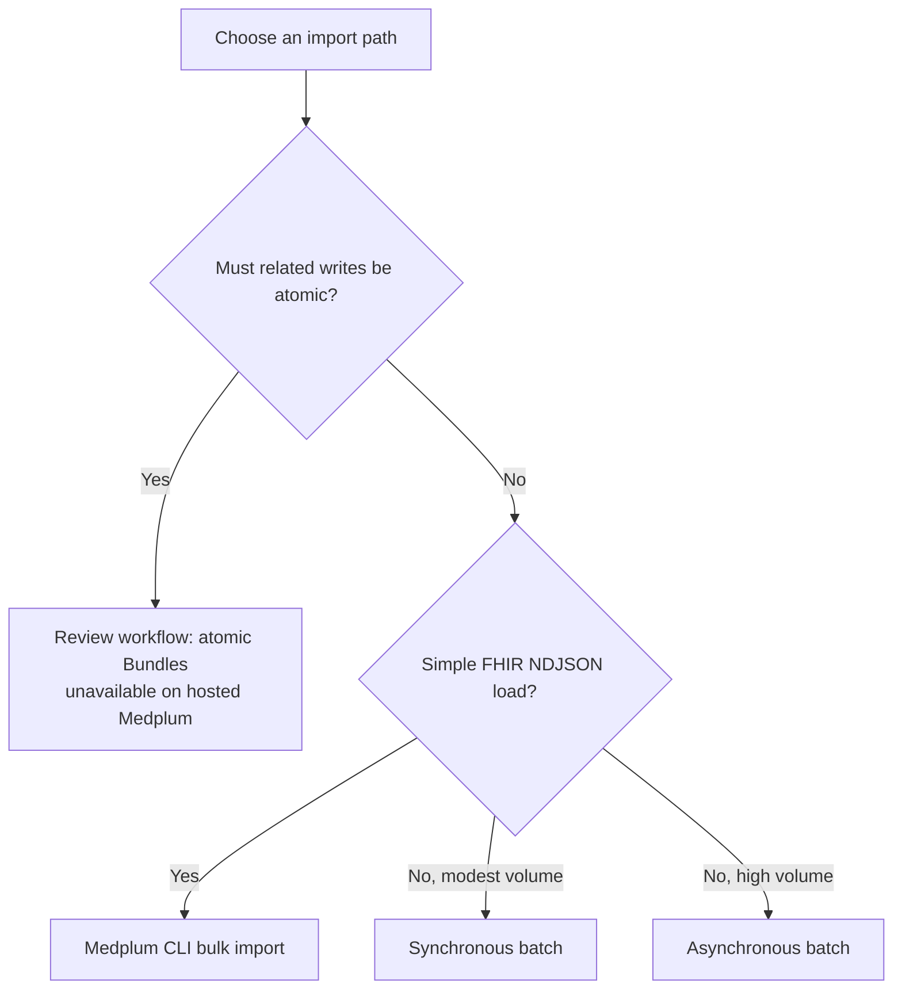

This guide covers reliable, restartable pipelines for writing migrated data to Medplum. It focuses on idempotency, batch and transaction choices, asynchronous processing, recovery, throughput, and files.

[patient]: /docs/api/fhir/resources/patient
[condition]: /docs/api/fhir/resources/condition
[encounter]: /docs/api/fhir/resources/encounter
[clinicalimpression]: /docs/api/fhir/resources/clinicalimpression

## Using Conditional Updates for Idempotency

Conditional updates prevent duplicate resources when a migration retries the same source record under a stable identifier. Define and test identifier uniqueness in [Governing Data Mappings](/docs/migration/mapping-governance#govern-identifier-systems) first.

To perform a conditional update, use a `PUT` operation with a search query in the URL:


  

  
  

  
  

  


The semantics of this operation are:

- If 0 resources are found matching the search query, a new resource is created.
- If 1 resource is found, it is updated with the provided data.
- If more than 1 resource is found, an error is returned.

This approach is safe to repeat while the migration source remains authoritative for the fields being replaced. After Medplum users or integrations can modify the target, a stale rerun can overwrite newer data. Use a source-of-truth rule, compare versions, or route the update for conflict handling before replacing an existing resource.

You can read more about Conditional Updates [here](/docs/fhir-datastore/working-with-fhir#upsert).

## Using Batch Requests for Efficiency

[FHIR batch requests](/docs/fhir-datastore/fhir-batch-requests) combine independent operations into one API call. Each entry can succeed or fail separately.

### Example: Writing Multiple Patient Resources

Here's an example of using a batch to create multiple [`Patient`][patient] resources:



This batch creates or updates [`Patient`][patient] resources using conditional updates. Add one entry per independent source record.

## Linking Resources in Dependency Order {#using-transactions-for-data-integrity}

Related resources do not automatically require an atomic transaction. For a migration where partial progress can be reconciled, load prerequisites first, record successful writes, and then load their dependents. Use conditional upserts keyed on stable source identifiers in each stage.

### Example: Encounter with Clinical Impression

An [`Encounter`][encounter] and its [`ClinicalImpression`][clinicalimpression] can be loaded in two stages. Starting with `savedPatient` from the Patient upsert above, this example saves the Encounter first and uses its returned ID when saving the assessment. If the second write fails, retain the first result and retry the assessment after resolving the failure. The Encounter may exist before its assessment; use this pattern only when that intermediate state is acceptable.



For higher volume, batch independent Encounters, inspect every result, then batch ClinicalImpressions only for successful Encounters. Do not write dependents whose prerequisites failed.



If a partially committed group would violate a business rule, staged writes and batch retries are insufficient. Atomic transaction Bundles are currently unavailable on hosted Medplum. Resolve that requirement in the migration design before loading data; see [Batches vs Transactions](/docs/fhir-datastore/fhir-batch-requests#batches-vs-transactions).



## Choosing Synchronous or Asynchronous Processing

Choose the write path based on input format, atomicity, and volume:



- Use [`medplum bulk import`](/docs/cli#import) only for a simple NDJSON load that does not require source ID preservation, cross-resource ID rewriting, or safe reruns.
- If writes must commit together, review the requirement before choosing a hosted load path. Batches cannot provide an all-or-nothing commit.
- Use synchronous batches for modest volumes of independent writes that need an immediate response.
- Use [asynchronous batch processing](/docs/fhir-datastore/processing-async-bundles) for high-volume independent writes that may exceed synchronous request-size, timeout, or FHIR interaction quota constraints.



The CLI chunks NDJSON into synchronous transaction Bundles containing POST creates. Medplum assigns new resource IDs, and the CLI does not add conditional-write idempotency or rewrite references based on source IDs. It retries 429 responses, but other failed entries require review. Use a custom conditional-write pipeline when identifiers, references, or reruns must be controlled.

The Bundle type does not provide atomicity on hosted Medplum. Inspect every result and handle partial success; do not blindly rerun POST creates.



Asynchronous batches require the `async-batch` feature flag on the Medplum project. For Medplum-hosted projects, contact [Medplum support](mailto:support@medplum.com) to enable it.



Asynchronous processing accepts a FHIR `batch` Bundle with the `Prefer: respond-async` header. Entries still succeed or fail independently.



Save the returned status URL, poll with backoff until the `AsyncJob` reaches a terminal state, and inspect the resulting response.



Async batches do not provide atomicity. On deployments with atomic transaction support enabled, Medplum rejects `type: transaction` with `Prefer: respond-async`. Use an asynchronous batch only when partial success is acceptable; switching processing modes does not satisfy an atomicity requirement.





Medplum's [Bulk FHIR API](/docs/api/fhir/operations/bulk-fhir) exports data in NDJSON. The `medplum bulk import` command is a client-side loader, not a server-side Bulk FHIR import operation.



## Making the Pipeline Restartable

A production migration should be resumable from a checkpoint without recreating successful resources or rerunning the complete dataset.

1. Assign every in-scope source record a stable source identifier.
2. Record each extraction partition or input file in a migration manifest.
3. Record the submitted bundle or job ID and the status of every in-scope source record.
4. Separate successful, rejected, skipped, and quarantined records.
5. Retry only failed records after correcting the data or mapping.

Conditional updates make retries idempotent while the source remains authoritative, but they do not replace result tracking. Inspect every `entry.response`; see [Inspect Every Write Result](/docs/migration/validation-and-reconciliation#inspect-every-write-result).

## Authenticating a Long-Running Pipeline

Run migrations with a dedicated [`ClientApplication`](/docs/auth/client-credentials) rather than a personal access token. Give its `ProjectMembership` a narrowly scoped `AccessPolicy`, and manage its credentials and quota independently from interactive users.

For a long-running process, we recommend using [`setBasicAuth`](/docs/sdk/core.medplumclient.setbasicauth). The Medplum SDK will send the client ID and secret directly with HTTP Basic authentication on each API request:

```ts
import { MedplumClient } from '@medplum/core';

const medplum = new MedplumClient();
medplum.setBasicAuth(process.env.MEDPLUM_CLIENT_ID as string, process.env.MEDPLUM_CLIENT_SECRET as string);
```

This avoids managing an expiring bearer token during a backfill. OAuth2 client credentials also support machine-to-machine workloads, and `MedplumClient.startClientLogin` can authenticate again using the stored client ID and secret. If you manage OAuth tokens outside the SDK, however, you must renew them rather than relying on a single one-hour access token.

Keep the secret in your deployment's secret manager or environment. Never place it in source code, migration manifests, FHIR resources, logs, or command history. Use HTTPS, rotate the credential after the migration, and verify that the migration identity can perform only the required operations.

## Controlling Throughput

Benchmark the real resource mix before choosing concurrency. Patient count alone is not a useful throughput estimate because one patient may expand into many resources and trigger downstream automation.

- Use bounded concurrency and exponential backoff for `429 Too Many Requests` responses.
- Monitor the `RateLimit` response header and the [Rate Limits dashboard](/docs/rate-limits).
- Run large backfills outside peak clinical traffic when possible.
- Use a dedicated `ClientApplication` for the migration so its credentials, access policy, and quota can be managed independently.
- Ensure the migration identity's `AccessPolicy` permits every interaction the pipeline performs. This commonly includes create and update on migrated resource types, searches used by conditional operations, reads used for verification, and `AsyncJob` and result `Binary` access for asynchronous batches.
- Account for Subscription and Bot side effects using [Plan Subscription and Integration Behavior](/docs/migration/adoption-strategy#plan-subscription-and-integration-behavior).

Do not assume that raising a quota will solve worker, queue, database, or downstream-integration bottlenecks. Measure each stage at production scale when volume or the cutover window creates material risk.

## Migrating Binary Files

Treat files as a separate pipeline workstream. Prefer `createMedia` or `createDocumentReference`, which create a metadata resource and use it as the Binary security context. If you use the lower-level `createBinary` or `createAttachment` helpers, provide an appropriate patient-linked `securityContext` explicitly. See [Binary Data](/docs/fhir-datastore/binary-data).

Reference stored content with the resulting `Binary/{id}` URL rather than placing large base64 data in `Attachment.data`.

If the source provides URLs that Medplum can access, the [auto-download setting](/docs/self-hosting/server-config#autodownloadenabled) can copy the content into Medplum storage. For patient documents, populate `DocumentReference.subject` so the metadata participates in the patient's compartment. The downloaded `Binary` uses the DocumentReference as its security context.

Reconcile file counts and bytes, verify downloads complete, open representative files, and test retrieval using both intended and unauthorized roles.

## An End-to-End Example

Let's demonstrate a complete data pipeline that incorporates all the concepts we've discussed. We'll migrate patients, conditions, encounters, and clinical impressions in separate steps.

### Source Data

#### Patients Table

```
| patient_id | first_name | last_name | birth_date | gender |
| ---------- | ---------- | --------- | ---------- | ------ |
| P001       | John       | Doe       | 1980-07-15 | M      |
```

#### Conditions Table

```
| condition_id | condition_name | icd10_code |
| ------------ | -------------- | ---------- |
| HT001        | Hypertension   | I10        |
```

#### Patient_Conditions Table:

```
| patient_condition_id | patient_id | condition_id | onset_date |
| -------------------- | ---------- | ------------ | ---------- |
| PC001                | P001       | HT001        | 2022-03-15 |
```

#### Encounters Table:

```
| encounter_id | patient_id | date       | type      |
| ------------ | ---------- | ---------- | --------- |
| E001         | P001       | 2023-06-15 | checkup   |
```

#### Clinical Impressions Table:

```
| clinical_impression_id | encounter_id | patient_id | summary                                                                        |
| ---------------------- | ------------ | ---------- | ------------------------------------------------------------------------------ |
| CI001                  | E001         | P001       | Patient presented with mild flu-like symptoms. Recommended rest and fluids.    |
```

### Step 0: Approve the Mapping

Before loading data, profile the source and approve each transformation. The [mapping register example](/docs/migration/mapping-governance#example-mapping-record) shows how `patients.birth_date` maps to `Patient.birthDate` for the source data above.

### Step 1: Create Patients

For this single-patient example, upsert the [`Patient`][patient] using the primary key from the source system as the identifier. Keep the returned `savedPatient` for the dependent writes in Step 3. At scale, batch independent Patient upserts and record each successful result before loading dependents.



### Step 2: Create Conditions

Use a batch request to upload [`Conditions`][condition] independently, using conditional references to link to the existing patients.



### Step 3: Create Encounters and ClinicalImpressions

Upsert each [`Encounter`][encounter] before its [`ClinicalImpression`][clinicalimpression], using the saved Encounter reference. At scale, use separate batches for the two stages and submit dependents only after confirming their prerequisite writes. Record and reconcile partial progress.



This example demonstrates:

1. Loading [`Patients`][patient] and [`Conditions`][condition] in separate stages.
2. Employing conditional updates for idempotency.
3. Using conditional references to link [`Conditions`][condition] to [`Patients`][patient].
4. Saving each [`Encounter`][encounter] before its dependent [`ClinicalImpression`][clinicalimpression].
5. Linking dependents through the saved resource IDs and recovering failed writes separately.
6. Maintaining relationships between resources across different requests using conditional references.

This approach preserves reference relationships while allowing recoverable partial progress. It does not provide an atomic commit across the migrated resources.

Next, [validate and reconcile the migrated data](/docs/migration/validation-and-reconciliation). The manifest and reconciliation examples continue with source patient `P001` from this pipeline.
