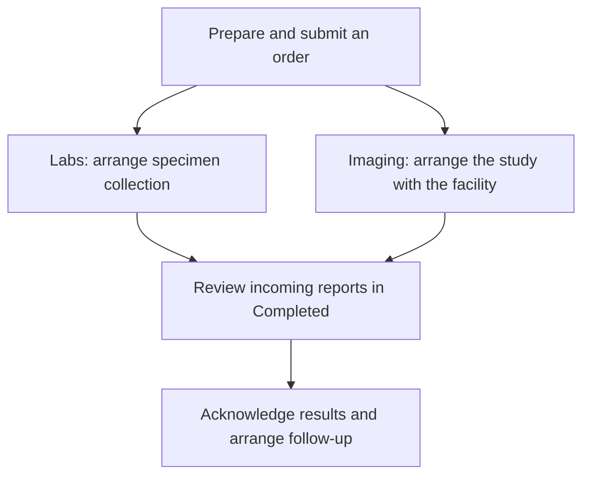

The **Orders** area in a patient's chart brings together laboratory and imaging orders, requisition documents, and results. Use it to prepare an order, return to a draft, and review the performing facility's report when results arrive.


Ordering through the standard Provider application uses the [Health Gorilla integration](/docs/integration/health-gorilla). Configure the project, ordering practitioner, and accounts for the performing laboratory or imaging facility. The facilities and procedures available to order depend on your integration setup and their catalogs.


Projects that receive results through other interfaces can also use this page to read existing FHIR orders and reports. Coordinate specimen collection or an imaging appointment through your organization's process, then return to Orders to review the results:

## Understand the views

| View          | Contents                                                                                                                                |
| ------------- | --------------------------------------------------------------------------------------------------------------------------------------- |
| **Open**      | Top-level orders with an active, draft, or on-hold status. Select an order to review its details and available requisition documents.   |
| **Completed** | Final, corrected, amended, preliminary, and partial diagnostic reports. Select a report to review its results and supporting documents. |
| **Revoked**   | Top-level orders whose status is revoked.                                                                                               |

These are the default status filters; filters in the page URL can narrow or change the results. The Open and Revoked views show orders (`ServiceRequest`); Completed shows results (`DiagnosticReport`). The views include both lab and imaging records and do not apply a laboratory-only category filter by default.


The **Completed** view includes preliminary and partial results, marked with a status badge. Check the individual report before treating it as final. Appearing in this view also does not record a clinician's acknowledgement or completion of follow-up work.


## Create an order

Labs and imaging use the same order form. Some controls retain lab-specific labels, including **Order Labs**, **Performing lab**, and **Selected tests**.

1. Open the patient's chart and select **Orders**.
2. Select **Order Labs**, the plus button above the list.
3. Confirm the **Patient** and **Requester**. In **Performing lab**, select the laboratory or imaging facility, then confirm its account information.
4. In **Selected tests**, search the selected facility's catalog and choose the lab tests or imaging studies to order.
5. Complete the diagnoses, billing information, and any questions shown for the selected procedures. Review **Priority**, procedure-specific **Notes**, and **Order notes**. Enter **Specimen collection time** when applicable to a laboratory order.
6. Review the order and choose **Submit Order**.

The application creates the order and submits it through the configured integration. Wait for the success notification and review the resulting order. If submission fails, inspect the error and the existing order before trying again; a failure after record creation can leave an order that needs reconciliation.

### Ordering an imaging study

- **Choose the imaging facility first.** The **Selected tests** search uses that facility's catalog. If the facility or study is missing, ask your integration administrator to check availability and setup.
- **Review the exact study and requested information.** Select the appropriate catalog entry and answer any procedure-specific questions. Use the notes fields for additional information requested by the facility.
- **Coordinate the appointment.** Submitting the order sends the request through the integration. Arrange the study with the facility using your organization's scheduling process.
- **Track the request and requisition.** Return to **Open** and select the order. In **Order Details**, review the **Requisition Document** when the integration has supplied one.

## Save and resume a draft

Choose **Save Draft** when you need to complete the order later. Drafts appear in **Open** alongside active and on-hold orders.

To resume a draft:

1. Select it in **Open** and choose **Active** from its status menu.
2. Review the saved information in the reopened order form.
3. Choose **Submit Order** when the order is ready.

After successful submission, the app attempts to revoke the superseded draft and displays the submitted order. If that cleanup reports an error, check for the submitted order before sending the draft again.

Saving a draft records preparation work. Submission is the step that sends the order through the integration.

## Review results

1. Open **Completed** and select the lab or imaging report. Use pagination and filters to find older records.
2. Check the report's status, including whether it is preliminary, partial, final, amended, or corrected.
3. Review the attached report under **Lab Document** when available. This label is also used for imaging report documents. Structured result observations appear below the documents when the integration supplies them.
4. Record acknowledgement, patient communication, and follow-up through your organization's workflow. See [Results and Review](/docs/labs-imaging/results-and-review) for how to model those responsibilities.

When a report links to an order, the details pane opens the order's **Report** tab with the selected report. You can also open an order and select **Report** when a linked report is available.

### Reviewing imaging reports

The imaging result can arrive as a report document, such as a radiology PDF, without a table of lab values. Open the document under **Lab Document** to read the facility's report. A missing document can mean that it has not arrived or that its association with the report needs investigation.

The Orders page supports reviewing imaging reports. Viewing the underlying DICOM study uses a separate [DICOM viewer](/docs/dicom/ohif-viewer).

### Connecting a custom results interface

For implementers, the report view displays:

- Attachments in `DiagnosticReport.presentedForm`, including entries that resolve through a `DocumentReference`.
- Documents linked through `Observation.derivedFrom` on the report's result observations, including nested observation groups.
- Structured results when `DiagnosticReport.result` contains observations.


The current Orders view does not display `DiagnosticReport.conclusion` by itself when the report has no result observations. If your interface sends only that field, provide the report as a supported attachment or customize the display. Verify a representative imaging report in Provider before enabling the interface for clinical use.


## Troubleshooting

| What you see                                       | What to check                                                                                                                                                                              |
| -------------------------------------------------- | ------------------------------------------------------------------------------------------------------------------------------------------------------------------------------------------ |
| A facility, test, or imaging study is unavailable  | Confirm the integration setup, ordering practitioner's configuration, facility account, and selected facility's catalog.                                                                   |
| A saved order has not been sent                    | Check whether it is still a draft and review any submission error.                                                                                                                         |
| An expected result is absent from Completed        | Check whether a report has arrived, its status, and the current filters. A report with only a registered status is excluded by default. Review the source interface for delivery failures. |
| An order appears in Revoked after resuming a draft | Check for the new submitted order that superseded the draft.                                                                                                                               |
| An imaging report has a title but no content       | Check for report attachments and result observations. A report containing only `conclusion` needs attachment mapping or a display customization.                                           |

## Related guides

- [Ordering Labs and Imaging](/docs/labs-imaging/ordering-labs-imaging) covers the broader workflow and data model.
- [Health Gorilla](/docs/integration/health-gorilla) covers integration setup and operations.
- The public [Provider Orders page implementation](https://github.com/medplum/medplum/blob/main/examples/medplum-provider/src/pages/patient/LabsPage.tsx) demonstrates the `LabOrdersPanel` component for custom applications.
