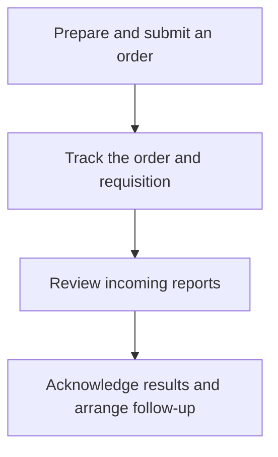

The **Orders** area in a patient's chart brings together lab orders, requisition documents, and results. This guide covers the lab workflow: preparing an order, returning to a draft, and reviewing a report when results arrive.


Ordering through the standard Provider application uses the [Health Gorilla integration](/docs/integration/health-gorilla). Configure the project, ordering practitioner, and lab accounts before submitting an order.


Projects that receive results through other interfaces can also use this page to read existing FHIR orders and reports. Follow an order from preparation through results and follow-up:

## Understand the views

| View          | Contents                                                                                                                                |
| ------------- | --------------------------------------------------------------------------------------------------------------------------------------- |
| **Open**      | Top-level orders with an active, draft, or on-hold status. Select an order to review its details and available requisition documents.   |
| **Completed** | Final, corrected, amended, preliminary, and partial diagnostic reports. Select a report to review its results and supporting documents. |
| **Revoked**   | Top-level orders whose status is revoked.                                                                                               |

These are the default status filters; filters in the page URL can narrow or change the results. The Open and Revoked views show orders (`ServiceRequest`); Completed shows results (`DiagnosticReport`).


The **Completed** view includes preliminary and partial results, marked with a status badge. Check the individual report before treating it as final. Appearing in this view also does not record a clinician's acknowledgement or completion of follow-up work.


## Create an order

1. Open the patient's chart and select **Orders**.
2. Select **Order Labs**, the plus button above the list.
3. Confirm the patient and requester, then select the performing lab and account information.
4. Choose the tests, diagnoses, and billing information required for the order. Add order notes and specimen collection time when applicable.
5. Review the order and choose **Submit Order**.

The application creates the order and submits it through the configured integration. Wait for the success notification and review the resulting order. If submission fails, inspect the error and the existing order before trying again; a failure after record creation can leave an order that needs reconciliation.

## Save and resume a draft

Choose **Save Draft** when you need to complete the order later. Drafts appear in **Open** alongside active and on-hold orders.

To resume a draft:

1. Select it in **Open** and choose **Active** from its status menu.
2. Review the saved information in the reopened order form.
3. Choose **Submit Order** when the order is ready.

After successful submission, the app revokes the superseded draft and displays the submitted order.

Saving a draft records preparation work. Submission is the step that sends the order through the integration.

## Review results

Open **Completed** and select a report to see its results. Where available, the report view includes associated observations and documents. Use pagination and filters to find older records.

For an order, the details pane can display requisition PDFs when the integration has supplied the corresponding documents. A missing PDF can mean that the document has not arrived or that its association with the order needs investigation.

After reviewing a result, follow your organization's process for acknowledgement, patient communication, and follow-up tasks. See [Results and Review](/docs/labs-imaging/results-and-review) for how to model those responsibilities.

## Troubleshooting

| What you see                                       | What to check                                                                                                                                                                              |
| -------------------------------------------------- | ------------------------------------------------------------------------------------------------------------------------------------------------------------------------------------------ |
| Tests or lab accounts are unavailable              | Confirm the Health Gorilla setup and the ordering practitioner's configuration.                                                                                                            |
| A saved order has not been sent                    | Check whether it is still a draft and review any submission error.                                                                                                                         |
| An expected result is absent from Completed        | Check whether a report has arrived, its status, and the current filters. A report with only a registered status is excluded by default. Review the source interface for delivery failures. |
| An order appears in Revoked after resuming a draft | Check for the new submitted order that superseded the draft.                                                                                                                               |

## Related guides

- [Ordering Labs and Imaging](/docs/labs-imaging/ordering-labs-imaging) covers the broader workflow and data model.
- [Health Gorilla](/docs/integration/health-gorilla) covers integration setup and operations.
- The public [Provider Orders page implementation](https://github.com/medplum/medplum/blob/main/examples/medplum-provider/src/pages/patient/LabsPage.tsx) demonstrates the `LabOrdersPanel` component for custom applications.
