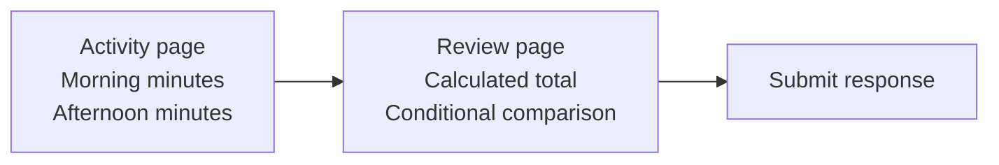

Use advanced questionnaire features to break long forms into pages, show relevant questions, and calculate answers from earlier responses. This guide covers the behavior of Medplum's `QuestionnaireForm` React component and its `useQuestionnaireForm` hook.

Start with [Modeling Questionnaires and Responses](/docs/questionnaires/questionnaires-and-responses) for item types, `linkId`, initial values, and basic `enableWhen` rules. To connect a form to storage, continue with [Saving and Resuming Responses](/docs/questionnaires/saving-and-resuming).

## Choose the feature you need

| Goal                                                  | Use                                                                                                                           |
| ----------------------------------------------------- | ----------------------------------------------------------------------------------------------------------------------------- |
| Show a question based on another answer               | `enableWhen`; set `enableBehavior` when combining conditions                                                                  |
| Show a question using more complex logic              | SDC `enableWhenExpression` with FHIRPath                                                                                      |
| Calculate an answer from other answers                | SDC `calculatedExpression` with FHIRPath                                                                                      |
| Split a long form into steps                          | Top-level groups with the `page` item control                                                                                 |
| Collect several entries, such as multiple medications | A repeating group; see [intake questionnaire design](/docs/intake/intake-questionnaires#structure-groups-and-repeating-items) |
| Prefill from patient or encounter data                | Load the data in your application and supply a `QuestionnaireResponse`                                                        |

The [compatibility table](#supported-features-and-imported-forms) describes the supported subset of Structured Data Capture (SDC). Check it before importing a form from another authoring tool.

## Build a two-page activity log

The example records morning and afternoon activity, calculates their total, and asks for a comparison when both values are greater than zero.

### Try the complete example

The definition is authored in TypeScript with `@medplum/fhirtypes`; its extensions are stored as ordinary Questionnaire JSON. Save the definition below as `advanced-questionnaires.ts`. The following sections explain its parts.

Complete TypeScript definition



In an existing [Medplum React application](/docs/react), add this preview component and render `<ActivityPreview />` inside your Medplum and Mantine providers:



Try this sequence:

1. Enter **15** morning minutes and **25** afternoon minutes, then choose **Next**.
2. The Review page opens with **40** total minutes and a comparison question. Expand **Current response** to inspect the calculated answer and its `linkId`.
3. Choose **Back**, change afternoon minutes to **0**, and choose **Next** again. The total becomes **15**, and the comparison question disappears.
4. Choose **Submit**. The preview response changes to `completed` in browser state. The [next guide](/docs/questionnaires/saving-and-resuming) adds persistence and completion validation.

The preview exposes both the form and response data so you can compare them. The current renderer has [calculated-field display limitations](#expression-behavior-and-limits), including lack of `item.readOnly` enforcement.

### Define the inputs

Use stable, unique `linkId` values so expressions and saved answers continue to identify the same questions. These two inputs will be placed in the first page's group:



### Calculate an answer

Add the [`calculatedExpression`](https://hl7.org/fhir/uv/sdc/StructureDefinition-sdc-questionnaire-calculatedExpression.html) extension to the item receiving the result:



The TypeScript constants build an expression that selects both inputs and adds their values. For example, **15 morning minutes + 25 afternoon minutes = 40 total minutes**. Each `iif()` supplies zero when its input is unanswered. Define the appropriate incomplete-answer behavior for your own assessment.

### Show a question using an expression

Use basic `enableWhen` for straightforward comparisons. When the condition needs FHIRPath, add [`enableWhenExpression`](https://hl7.org/fhir/uv/sdc/StructureDefinition-sdc-questionnaire-enableWhenExpression.html) to the question or group:



This question appears only when both activity inputs are positive. The expression reads the whole response, so it works across the two pages. Return a Boolean and test the unanswered state as well as true and false results. Use one condition mechanism per item; an expression takes precedence over `enableWhen` when both are present.

Disabled questions are omitted from callback responses. See [expression behavior and limits](#expression-behavior-and-limits) for how this affects saving and resuming.

### Arrange the items into pages

Wrap each page in a top-level `group` and give it a `questionnaire-itemControl` extension with code `page`. Assemble the items defined above:



- **Mark the first group as a page.** The renderer uses the first item's control to enable pagination, then treats each top-level item as a page. Keep all top-level items as page groups.
- **Use the group's `text` as the page title.** Short titles make the step indicator easier to scan.
- **Put conditions inside a page.** The step list is fixed; a disabled page group can leave an empty step rather than being skipped.
- **Use Next, Back, and Submit.** Next checks browser validity on the current page. Submit appears on the last page. Page navigation alone does not save a response.
- **Set `disablePagination` to show all groups together.** This is also useful for reviewing the full form during development.

The example's Review page shows the calculated total when that page mounts. Test returning to Activity, changing an answer, and navigating forward again.

## Expression behavior and limits

Expressions run when the response initializes and when answers change. Use `language: 'text/fhirpath'`; these form extensions do not evaluate CQL or run FHIR search queries. Keep these rules in mind:

- **`%resource` is the entire `QuestionnaireResponse`.** It is also the expression's starting context, even when the calculation is on a nested item.
- **Follow the response structure.** `item.where(...)` finds top-level items; `item.item.where(...)` finds questions inside this example's page groups. Add the appropriate path for deeper groups or answers nested under `answer.item`.
- **Test the functions you use.** Medplum's FHIRPath evaluator implements a subset of the language. For example, this calculation uses `iif()` and arithmetic; `sum()` and `repeat()` are not implemented in the current evaluator.
- **Return one value of the item's answer type.** The renderer uses the first expression result and writes one answer. Use an integer result for an `integer` item, for example.
- **Handle cleared inputs.** An expression that returns an empty collection leaves the previous calculated answer in place. Use a deliberate fallback or application logic when the result should be cleared.
- **Keep dependencies simple.** Evaluation walks items in definition order once per change. Put a calculated dependency before its consumers; avoid circular calculations. Repeated-group calculations need additional care, as described below.


Calculated expressions update the response data. Check the display separately:

- Current text and number inputs use initial display values, so an already-mounted input may not visibly refresh when its calculated answer changes.
- The renderer does not enforce `item.readOnly`. For a live, non-editable summary, render the calculated value from `onChange` in your application.

Verify both the display and saved response. Validate calculations that drive clinical or workflow decisions in server-side processing.


When a condition becomes false, the form keeps the previous answer in its local editing state so it can reappear if the condition becomes true again. Disabled items are removed from `onChange` and `onSubmit` responses. After saving and reopening, an omitted answer is no longer available to restore.


The current renderer treats `questionnaire-hidden: true` as disabled and removes those items from callback responses too. Use application-managed context for values you need to retain without displaying them.


## Use repeating items deliberately

`repeats: true` on a question collects several answers to that question. On a `group`, it collects several instances of the entire group. Keep the nested structure intact when saving and extracting responses; see [Intake Questionnaires](/docs/intake/intake-questionnaires).

The current calculated-expression evaluator matches the first response item for each `linkId` at each level. It does not calculate a separate result in every repeated group. Basic `enableWhen` lookups also find the first matching question rather than establishing a local context for each repetition. For calculations or conditions specific to each repeated row, use application logic or a custom renderer and test multiple repetitions.

## Supported features and imported forms

This table describes the current Medplum form renderer. SDC covers a wider set of capabilities, and support for a feature in an imported definition does not follow from successfully loading that definition.

| Feature                                                                  | Current behavior                                                                                                                                                                      |
| ------------------------------------------------------------------------ | ------------------------------------------------------------------------------------------------------------------------------------------------------------------------------------- |
| `initial`, `answerOption.initialSelected`                                | Supplies initial answers; existing non-empty response answers take precedence.                                                                                                        |
| `enableWhen`, `enableBehavior`                                           | Evaluates answer-based conditions; account for the repeated-group behavior above.                                                                                                     |
| SDC `enableWhenExpression`                                               | Evaluates FHIRPath against the response.                                                                                                                                              |
| SDC `calculatedExpression`                                               | Evaluates FHIRPath and stores the first result as an answer, with the calculation and display limitations above.                                                                      |
| `questionnaire-itemControl`                                              | Supports page groups and choice controls including radio buttons, checkboxes, and dropdowns. Other control codes do not guarantee a matching widget.                                  |
| `answerValueSet`                                                         | Loads choices from a ValueSet. Verify the terminology is available in the target project.                                                                                             |
| `questionnaire-optionExclusive`                                          | An exclusive answer option clears other selections; selecting another option clears the exclusive choice.                                                                             |
| `questionnaire-hidden`                                                   | Hides the item and excludes it from callback responses.                                                                                                                               |
| `questionnaire-referenceResource`, `questionnaire-referenceFilter`       | Configures reference inputs. Filters can use `$subj` and `$encounter` from the component props.                                                                                       |
| `item.readOnly`                                                          | Not enforced by the current renderer; implement read-only presentation in your application.                                                                                           |
| SDC `initialExpression`, `launchContext`, `variable`, `answerExpression` | No built-in evaluation in this form renderer. Load context and populate answers or choices in application code. `%patient` and `%encounter` are not supplied as expression variables. |
| Signature capture                                                        | Supported on the single-page form; see [Consent and Signatures](/docs/consent). The paginated branch currently does not render the signature input.                                   |
| SDC template extraction                                                  | A separate server operation; see [Parsing Questionnaire Responses](/docs/questionnaires/parsing-questionnaire-responses). Form submission alone does not invoke it.                   |

Use this as a feature-level compatibility checklist. When importing a questionnaire:

1. Inventory its extensions, expression languages, terminology dependencies, and nested or repeating structures.
2. Check each required feature against the table and test it in the Medplum version you deploy.
3. Compare the visible form, callback data, and saved response using representative answers, including cleared and disabled answers.
4. Keep the tested definition available for existing responses. Follow [the form revision workflow](/docs/questionnaires/saving-and-resuming#change-a-form-without-breaking-existing-responses) when changing question structure, calculations, or extraction rules.

Continue with [Saving and Resuming Responses](/docs/questionnaires/saving-and-resuming) to connect this form to an application workflow.
