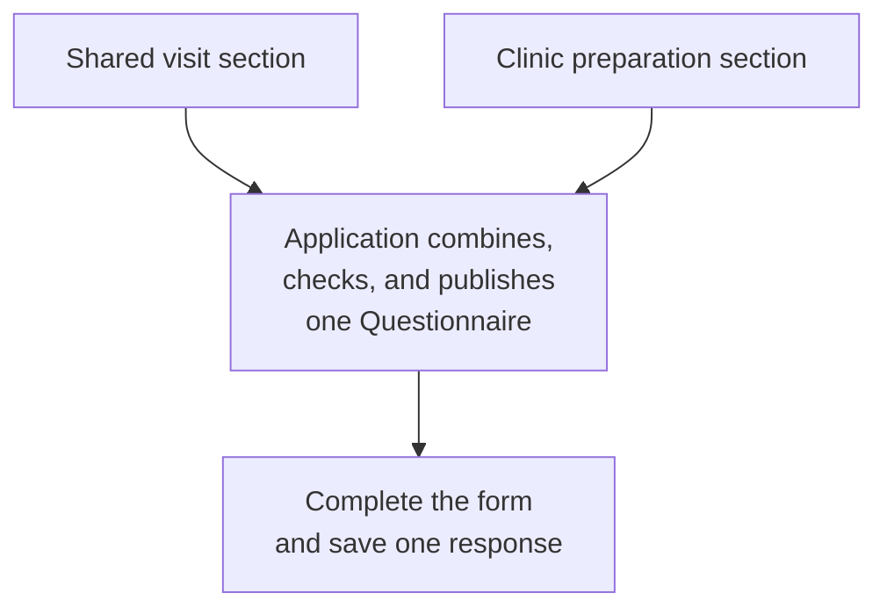

A clinic might use the same visit questions across several intake forms, then add a section specific to each service. Maintaining the shared questions once makes changes easier to review and keeps the forms consistent. A **composite questionnaire** brings those reusable pieces together into the form a patient or practitioner completes.

With Medplum today, your application can combine known Questionnaire definitions before publishing a complete `Questionnaire`. Medplum stores that definition, and `QuestionnaireForm` renders its questions and collects a single `QuestionnaireResponse`.

This guide walks through a shared visit section plus a clinic-specific preparation section. Start with [Modeling Questionnaires and Responses](/docs/questionnaires/questionnaires-and-responses) for item types and basic conditions.

## Choose between groups, modules, and separate forms

The word "nested" often describes the appearance of a form. Decide separately how its content is maintained and how responses should be saved.

| Need                                                                | Approach                                                               | Result                                                     |
| ------------------------------------------------------------------- | ---------------------------------------------------------------------- | ---------------------------------------------------------- |
| Organize questions into sections or show a follow-up conditionally  | Nested `item` groups and `enableWhen` within one Questionnaire         | One definition with its questions inline                   |
| Maintain shared content independently and reuse it in several forms | Compose reusable modules before publishing each complete Questionnaire | One complete definition and one response per assigned form |
| Assign assessments that need separate completion or review          | Keep separate Questionnaires; coordinate them in the visit workflow    | Separate responses with their own lifecycles               |

A module can contain nested groups, and the complete form can preserve them. The difference is **reuse during authoring**: a nested group already contains its questions, while modular authoring lets several forms draw from the same maintained source. For coordinating separate forms, see [Visit Templates and the SOAP Approach](/docs/charting/visit-templates).

## Follow the composition flow

Compose and review the definition before assigning it to a respondent:

Keep the published definition available for its responses. When a module changes, review and publish a new complete form for new assignments. Existing assignments continue using their original definition.

### What Medplum supports

Medplum's current React renderer works with the complete Questionnaire's inline items, including nested groups and basic `enableWhen` conditions. Your application owns selecting modules and combining their content. Check the [advanced-authoring compatibility table](/docs/questionnaires/advanced-authoring#supported-features-and-imported-forms) for other features used by your modules.

FHIR's Structured Data Capture (SDC) guide defines a `subQuestionnaire` extension and an [`$assemble` operation](https://hl7.org/fhir/uv/sdc/STU4/en/OperationDefinition-Questionnaire-assemble.html) for modular authoring. **Medplum does not currently provide a built-in `$assemble` operation, and `QuestionnaireForm` does not expand `subQuestionnaire` references.** An imported definition that requires assembly needs application code or a compatible external assembler before it reaches the renderer.

## Build a visit-preparation form

The example uses two small, known modules:

- **Shared visit section:** asks what the patient would like to discuss.
- **Clinic preparation section:** asks whether the patient would like help preparing, then shows a follow-up when they answer yes.

Both are ordinary FHIR R4 Questionnaire definitions. We keep them in source code so their versions can be reviewed together. The composition function copies their item trees into a new definition. It is specific to these modules; importing arbitrary SDC forms requires the additional handling described [below](#using-sdc-modular-forms).

### 1. Define the reusable content

Save the following imports and definitions in `modular-questionnaires.ts`. Each module owns a distinct set of `linkId` values: `basics` and `basics-*` for the shared content, `clinic` and `clinic-*` for the clinic content. The condition refers to a question within its own module.

Two reusable Questionnaire definitions



The module URLs identify the source definitions. This example uses the imported constants directly, so it performs no canonical URL lookup. Replace the example URLs with ones you control if you publish these modules.

### 2. Combine the modules into one definition

Add this function and its duplicate-ID check to the same file:



Check linkIds across every group



The result has two top-level groups. Copying each entire item tree preserves its nested questions and `enableWhen` references. `deepClone` keeps edits to the composed form from changing the source modules. The ID check rejects collisions across the entire result, including within nested groups.

This function deliberately selects only the items from the two definitions above. Its output sets its own title, status, subject type, and version. If you add root-level extensions, contained resources, profiles, or other dependencies to a module, update the composition process to handle them before using that module. Copying `item` alone would leave those dependencies behind.

### 3. Try the complete form

In an existing [Medplum React application](/docs/react), save this as `composite-preview.tsx` beside the definition file. Render `<CompositePreview />` inside your Medplum and Mantine providers:



Try the following:

1. Enter "Discuss my upcoming visit" in **What would you like to discuss?**
2. Select **Would you like help preparing for your visit?** The question **What help would be useful?** appears.
3. Enter "Instructions for joining the video visit" and submit. Expand **Submitted response** to see the answers under both `basics` and `clinic` groups.
4. Clear the help checkbox and submit again. The follow-up question is hidden and its answer is omitted from the submitted response.

The preview keeps the definition and response in browser memory. Submission produces one response to the complete form; it does not produce a response for each module. The next step connects the definition to storage.

### 4. Publish and assign the complete form

After reviewing the form, add this helper to `modular-questionnaires.ts` and call `await publishVisitPreparation(medplum)` from your application's setup workflow:



Keep the returned Questionnaire ID in configuration. This identifier-based conditional create makes a retry reuse the existing definition. Replace the identifier system with one owned by your application. Reusing the same identifier after changing the code returns the previous definition; give each new published revision a new identifier.

The final definition uses the resource-ID strategy from [Saving and Resuming Responses](/docs/questionnaires/saving-and-resuming): load the stored Questionnaire by ID and assign a response that points to `Questionnaire/{id}`. The composed definition intentionally has no canonical `url`; the source module URLs identify the modules only. Keep a published resource unchanged while responses depend on it.

Continue with that guide for assignment identifiers, subject and encounter context, saving drafts, completion validation, and resuming the same response. Apply those steps to the complete definition returned here.

## Keep revisions and processing together

Treat the composed form as a release of a particular set of module versions. Record that set in source control or your publishing configuration. An update to a source module should lead to a reviewed release, with a new complete Questionnaire resource, rather than changing the form beneath an existing response.

Before publishing a revised form:

- Check all `linkId` values for uniqueness and confirm every `enableWhen.question` still identifies the intended question. Prefixing IDs during composition also requires updating references and any expressions that use them; this example authors distinct IDs in advance.
- Test conditions, calculations, and prefilled answers against the complete response structure. Adding or removing a wrapper group changes paths used by FHIRPath expressions and processing code.
- Keep extraction or Bot logic aligned with the final definition. This example collects answers only. Add and test extraction templates if you use `$extract`; when following this resource-ID strategy, supply the loaded Questionnaire explicitly to that operation. Its automatic lookup uses `Questionnaire.url`.
- Verify that a saved response reopens against its original complete definition after you publish a newer revision.

See [Parsing Questionnaire Responses](/docs/questionnaires/parsing-questionnaire-responses) for choosing template extraction or a Bot and handling downstream writes. Form submission alone does not run that processing.

## Using SDC modular forms

For interoperability with other form-authoring tools, [SDC Modular Forms](https://hl7.org/fhir/uv/sdc/STU4/en/modular.html) describes referencing a child Questionnaire from a parent `display` item with `subQuestionnaire`. An assembler replaces that placeholder with the child's items before population and rendering. Version-specific references keep the selected content predictable.

An SDC assembler also handles dependencies such as contained resources, extension propagation, expression context, and ID collisions. The small composition function above implements the needs of its two known modules; it does not implement the SDC assembly algorithm or claim conformance to its Modular Questionnaire profile.

If your authoring tool produces SDC modular definitions, choose an assembler that supports their features, then inspect and test the complete output with Medplum's renderer. Successful assembly still needs the feature compatibility checks in [Advanced Questionnaire Authoring](/docs/questionnaires/advanced-authoring#supported-features-and-imported-forms).
