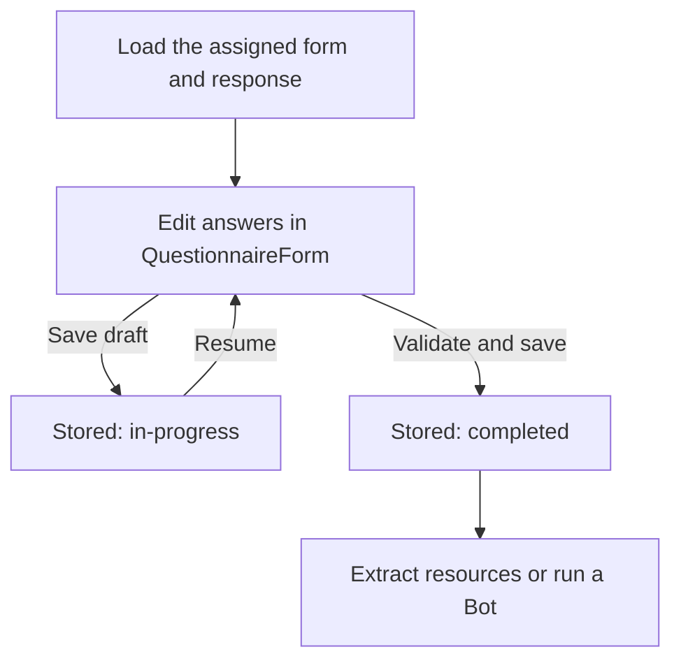

`QuestionnaireForm` manages answers and page navigation in the browser. Your application saves the `QuestionnaireResponse`, loads it when the user returns, and starts processing after completion.

This guide adds persistence to forms such as the [advanced activity-log example](/docs/questionnaires/advanced-authoring). It assumes an authenticated [Medplum React application](/docs/react) and access to the intended patient. The first step stores the form definition.

## Plan the response lifecycle

Keep one response per assigned instance of a form. A patient completing the same assessment at two visits usually needs two responses, while saving a draft several times should update the same response.

| Boundary        | Form behavior                                                            | Application responsibility                                        |
| --------------- | ------------------------------------------------------------------------ | ----------------------------------------------------------------- |
| Initialization  | Loads initial answers and evaluates calculations; emits `onChange`.      | Load the intended definition and response before editing.         |
| Editing         | Calls `onChange` with an in-progress answer snapshot.                    | Keep the latest snapshot and show whether it has been saved.      |
| Page navigation | Changes the visible page.                                                | Save explicitly or implement autosave.                            |
| Submission      | Calls `onSubmit` with `status: 'completed'` and an `authored` timestamp. | Validate the whole response, then save before showing completion. |

## Connect the activity-log example

The following steps connect the [activity-log definition](/docs/questionnaires/advanced-authoring#try-the-complete-example) to a saved response. Use these files in the same directory of an existing Medplum React application:

| File                           | Responsibility                                   |
| ------------------------------ | ------------------------------------------------ |
| `advanced-questionnaires.ts`   | The definition from the authoring guide          |
| `saving-responses.ts`          | The persistence and validation helpers below     |
| `saved-questionnaire-form.tsx` | The editor with Save draft and Submit            |
| `activity-form.tsx`            | Loading the assigned form and opening the editor |

Imports for saving-responses.ts



### 1. Store the form definition

Call `await publishActivityQuestionnaire(medplum)` in your application's setup workflow, then keep the returned Questionnaire ID in configuration. Repeating the call reuses the same definition. Replace the example identifier system with one owned by your application.

Helper: publish the example definition



Keep this definition unchanged once responses use it. To publish a new revision, use a new definition identifier and resource ID; see [changing a form](#change-a-form-without-breaking-existing-responses).

### 2. Create or load the assigned response

Use a stable assignment identifier to make draft creation safe to retry. Replace the example identifier system with one owned by your application, and reuse the same `assignmentId` when reopening or retrying that assignment.

Helper: create or reuse an assigned response



The helper returns the saved resource, including its server-assigned `id` and `meta`. It also checks that a reused assignment belongs to the expected subject and definition. Give each assigned instance its own identifier, including when the same patient repeats the form at a later visit.

Load the stored definition and response together before mounting the editor:



If the response ID is already known, load it directly with `medplum.readResource('QuestionnaireResponse', responseId)` and load its assigned definition.

- **Check the returned status.** Conditional creation may return a previously completed response. Reopening it for amendment should be a deliberate workflow.
- **Set the subject on the response itself.** Include `encounter`, `source`, and `author` according to your workflow. Access to patient data is enforced by [AccessPolicies](/docs/access/access-policies).
- **Keep the definition consistent.** The helper stores `Questionnaire/{id}`. Load the matching definition and avoid changing its question structure while responses are in progress.
- **Prefill in application code.** To use patient or encounter data, load it and populate the matching nested response items before mounting the form. Follow the structure and answer types of the Questionnaire.

### 3. Preserve context when saving

The form initializes its answer state from the supplied response. Its callbacks do not round-trip all of that resource's root fields, such as `id`, `meta`, `identifier`, and `encounter`. Merge the edited snapshot with the saved resource before updating it:

Helper: update the saved response with version checking



This helper keeps the assigned response's identity, subject, encounter, and Questionnaire reference. The `If-Match` header protects against overwriting a newer version saved by another editor. Keep the returned resource for the next save. On a `412 Precondition Failed`, reconcile with the current server version before retrying; see [version checking](/docs/fhir-datastore/updating-data#preventing-lost-updates-with-version-checking).

### 4. Validate completion across all pages

Drafts can be incomplete. **Validate the whole response before saving it as completed.** The component sets `status: 'completed'` in its submit callback; it does not perform a complete assessment of your form's rules. Next checks browser validity on the current page, and the final page does not contain the earlier pages' input controls.

For this example, both activity values must be non-negative whole numbers, and the total must match their sum:



This validator is specific to the activity log. For another form, validate its required enabled questions, answer types, ranges, and calculations. The editor below runs the supplied validator on completion and leaves the form open on failure. It still allows incomplete drafts. Enforce required business rules in your trusted server-side submission or processing workflow too; client-side checks provide respondent feedback.

### 5. Open the editor

Pass the saved response through the `questionnaireResponse` prop. The example below keeps a snapshot from `onChange`, saves drafts with a separate button, and persists the completed response from `onSubmit`.

- **Clone snapshots.** The form manages nested answer objects; copying the response keeps your save operation separate from later edits.
- **Preserve one mounted editing session.** Load a response before mounting, and use a React `key` based on its ID when switching to another response. Updating the response prop is not a controlled-state mechanism for replacing answers mid-session.
- **Pass context explicitly.** `subject` is used on submission; `subject` and `encounter` also support reference-input filters. These props do not create `%patient` or `%encounter` FHIRPath variables.
- **Handle save failures visibly.** Keep edits open, show the failure, and let the user recover. Show success only after the write resolves.

React example: explicit Save draft and Submit





The page below handles loading and errors, then supplies `validateActivityResponse` to the editor:

Complete activity-form.tsx page



Render `<ActivityFormPage key={assignmentId} questionnaireId={questionnaireId} patientId={patientId} assignmentId={assignmentId} />` inside your Medplum and Mantine providers. Supply the published definition ID, the intended patient's ID, and the stable identifier for this assigned form. This example uses explicit saves and closes editing after completion; add your application's navigation and review screen around it.

Try **Save draft**, unmount the page, and reopen it with the same assignment. The answers and response ID should remain the same. Submit valid answers and confirm that the saved status becomes `completed`.

When resuming, load the saved response again and mount a fresh form. The form starts on the first page with the saved answers; the current page index is not part of the response.


Callbacks omit disabled and hidden answers. Those answers can be restored locally if re-enabled during the same session, but a saved draft does not retain them. Root-level signature data is also not restored into the form's initial answer state. Test your signing and amendment workflow separately; see [Consent and Signatures](/docs/consent).


## If you add autosave

Use the same saved response ID and save helper. Add a debounce and serialize writes so an older draft cannot finish after a newer draft or a completed submission. Account for the initialization `onChange` event, which happens before the user edits a field. Before navigating away, await the pending save or give the user a clear unsaved-changes choice.

## Submit and process the completed response

The form's submit handler sets `status: 'completed'`, updates `authored`, and uses the supplied subject and source. If `source` is omitted, it uses the signed-in profile when available. For staff entering a patient's answers, set `source` to the patient and `author` to the practitioner recording them. `subject` identifies the patient the answers are about.

After completion validation:

1. **Save, then process.** Persist the completed response before invoking [SDC template extraction or a Bot](/docs/questionnaires/parsing-questionnaire-responses). Choose the processing path according to the mapping and workflow.
2. **Trigger on completion.** Draft creation and repeated saves also produce resource events. Scope subscriptions to the intended Questionnaire and completed status; use [transition criteria](/docs/subscriptions/subscription-extensions#expression-based-criteria) when appropriate.
3. **Handle retries.** Make downstream writes idempotent. If extraction and a Bot both run, give each clear ownership of its outputs.

`$extract` returns a Bundle for a separate write step. Inspect write results before treating the downstream workflow as complete.

## Change a form without breaking existing responses

A saved response depends on the definition's structure and the meaning of its questions. Adding a required item, changing a `linkId` or type, or changing a calculation can alter what happens when an old response is reopened.

For the resource-ID approach used in this example:

1. **Publish a new definition resource for a new revision.** Give it a new definition identifier and a descriptive `Questionnaire.version` value. Changing `version` on the same resource does not make a `Questionnaire/{id}` reference point to an older definition.
2. **Keep existing assignments on their original definition.** Use the new Questionnaire ID for new assignments. Keep old definitions available for resumption and historical review.
3. **Release processing changes with the definition.** Test expressions, completion validation, and extraction or Bot logic together before assigning the new revision.
4. **Make migration explicit.** If an in-progress response must move to the new revision, map the answers and validate the result. Preserve completed responses as historical records and handle corrections through your amendment workflow.

Canonical URLs are another referencing strategy. If your application uses them, define how it resolves a specific version before replacing this example's resource-ID approach.

## Check the whole journey

Before releasing a form, walk through it as an implementer and as a respondent:

- Enter answers, move forward and back, and check calculations after clearing an input.
- Enable a conditional question, answer it, disable it, and inspect the saved response.
- Save, close, and reopen. Confirm the response ID, subject, encounter, repeated groups, and answers are preserved.
- Simulate a failed save and a stale-version conflict; confirm the UI does not claim success or discard edits.
- Submit once, reopen the saved resource, and confirm only the intended downstream processing runs.

For form design and imported SDC features, see [Advanced Questionnaire Authoring](/docs/questionnaires/advanced-authoring).
