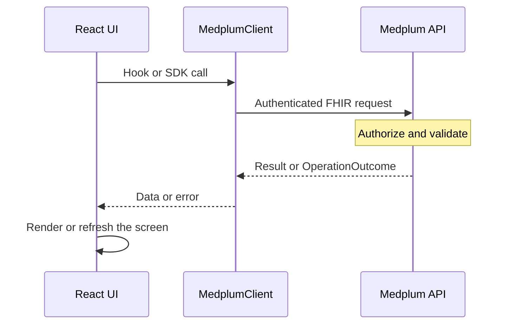

A Medplum React application combines a FHIR client, authentication state, and components for reading and editing healthcare data. This guide connects those pieces into an application you can extend.


- Complete the [React setup](/docs/react), including the providers and CSS imports.
- Configure a [ClientApplication](/docs/auth/medplum-as-idp) for your app's sign-in flow.
- Use a test project with synthetic data while developing the examples.


The examples below use the signed-in user's access. Follow them in order to handle authentication, display a patient search, and save a new patient.

## Choose your starting point

| Starting point                                                                           | Use it when                                                                                           |
| ---------------------------------------------------------------------------------------- | ----------------------------------------------------------------------------------------------------- |
| [Hello World](https://github.com/medplum/medplum/tree/main/examples/medplum-hello-world) | You want a small application with sign-in, patient pages, and resource forms.                         |
| [Medplum Provider](/docs/provider#building-a-custom-ehr)                                 | You want to customize an existing clinical application with patient charts and operational workflows. |
| Add Medplum to an existing app                                                           | You already have routing and a design system and want to add FHIR data and selected components.       |

The packages have distinct roles:

- **`@medplum/core`:** `MedplumClient`, FHIR requests, and shared data utilities.
- **`@medplum/react-hooks`:** authentication context and data hooks, usable with your own UI library.
- **`@medplum/react`:** FHIR controls and clinical components built with Mantine.

Use the same Medplum release across these packages. Requests flow from the UI through the shared client to the server:



## Set up the application boundary

Create a stable `MedplumClient` instance and pass it to `MedplumProvider`. Recreating it during each render also recreates client state such as caches and subscriptions. Browser applications use a public client ID; server-side client secrets belong in a trusted backend.

The installation guide shows the providers and CSS imports. Inside that boundary, wait for authentication to initialize before deciding whether to show the signed-in application:



Render your sign-in flow in `signIn` and your application's pages as children. Keying the application by the current membership remounts its local state when that membership changes.


The boundary chooses which screen to show. Configure the membership's [access policy](/docs/access/access-policies) to enforce which resources the user can read and write.


See [Authentication](/docs/auth) for choosing a sign-in flow and [Client Lifecycle Events](/docs/react/lifecycle-events) for profile and storage initialization.

## Search and display data

Use `useSearchResources` when a component needs a page of resources. It returns the results, a loading flag, and an `OperationOutcome`. Handle loading, failure, and an empty result separately so that users can tell whether a search completed.



This component shows the **first 20 matching patients**. For a paginated application, use `useSearch` to retain the full search `Bundle` and its links, or use `SearchControl` for a standard search interface. See [Paginated Search](/docs/search/paginated-search) before building your own pagination.

The search hooks debounce query changes by default. Their `enabled` option can defer a query until required context exists. For example, wait for a selected patient before searching that patient's records.

### Choose the right data interface

| Need                                           | Interface                                                            |
| ---------------------------------------------- | -------------------------------------------------------------------- |
| Resolve a resource reference for display       | `useResource(reference, setOutcome)`                                 |
| Render one page of matching resources          | `useSearchResources(resourceType, query)`                            |
| Inspect search metadata or follow paging links | `useSearch(resourceType, query)` or `medplum.search()`               |
| Read a known resource for an operation         | `medplum.readResource(resourceType, id)`                             |
| Save a resource                                | `medplum.createResource()`, `updateResource()`, or `patchResource()` |

`useResource` can resolve a reference from the client's cache. It does not establish a live subscription. Likewise, search results need an explicit refresh strategy when another screen or user changes the data.

## Build forms around a save operation

`ResourceForm` renders fields from a FHIR resource definition and calls `onSubmit` with the edited resource. Your application owns the save request, the error state, and what happens after success.



This example creates a new Patient and calls `onCreated` with the saved record. Use that callback to navigate to the patient or refresh the parent list. After success, unmount `CreatePatient` or reset it by changing its React `key` if it stays on screen; otherwise, submitting the retained values creates another Patient.

For ingestion or a workflow that may retry a business operation, define an identifier and use [conditional writes](/docs/fhir-datastore/working-with-fhir) to avoid duplicate records.

For an edit screen, start with the full resource and preserve its fields when saving. Use [version-aware updates](/docs/fhir-datastore/updating-data) when concurrent edits matter. The server validates the request; showing a form or having a TypeScript type does not establish conformance to a FHIR profile. See [Profiles](/docs/fhir-datastore/profiles).

## Keep screens current

After a successful write, update the screen from the saved resource or deliberately reload its data. The SDK's cache and the component's React state have different lifetimes. A write completing successfully does not mean every mounted list has rerun its query.

When a workflow needs a fresh read, use the SDK's request options, for example:

```ts
const patient = await medplum.readResource('Patient', patientId, { cache: 'reload' });
```

For changes made by other users, use [useSubscription](/docs/react/use-subscription) with narrowly scoped criteria. Refresh authoritative state when a notification arrives and after reconnecting. Notifications received while connected are useful signals; your screen also needs a way to recover changes missed while disconnected.

## Choose components by workflow

Start with the smallest component that owns the interaction you need. See [Choosing React Components](/docs/react/choosing-components) for a map from FHIR field controls to complete workspaces, with public examples you can adapt.

## Check the complete workflow

Test with representative project memberships and data before rollout:

- **Search:** show loading, no matches, multiple pages, and a failed request.
- **Save:** display validation errors, prevent repeated submission while saving, and refresh the screen after success.
- **Authentication:** recover from an expired session and clear local state when switching project memberships.
- **Access and concurrency:** verify restricted memberships and handle an update made by another user.
