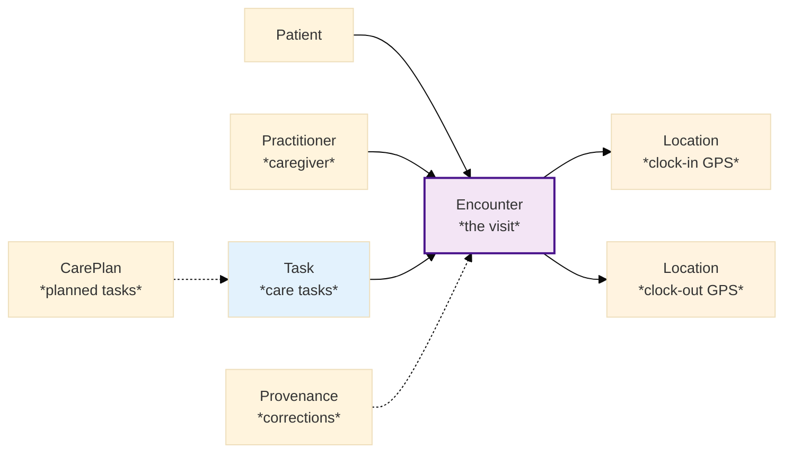

Home care agencies send caregivers to patients' homes to deliver personal care, homemaker, and home health services. Each visit needs a durable record of **who** delivered care, **to whom**, **where**, **when** it started and ended, and **what** was done. For Medicaid-funded services, U.S. states require this record as [Electronic Visit Verification (EVV)](https://www.medicaid.gov/medicaid/home-community-based-services/guidance/electronic-visit-verification-evv).

This page describes where each part of that record lives in FHIR, and how to stamp the time and GPS position when a caregiver clocks in and out. How visits get onto a caregiver's calendar is up to you: see [Connecting to Scheduling](#connecting-to-scheduling).

## Visit Data Model

| Resource | Role |
| --- | --- |
| [`Encounter`](/docs/api/fhir/resources/encounter) | The visit as it happened: who, for whom, when it started and ended, and the clock-in and clock-out locations. |
| [`Location`](/docs/api/fhir/resources/location) | One per clock event, holding the GPS position captured by the caregiver's device. |
| [`Practitioner`](/docs/api/fhir/resources/practitioner) | The caregiver, referenced from `Encounter.participant`. |
| [`Patient`](/docs/api/fhir/resources/patient) | The person receiving care, referenced from `Encounter.subject`. |
| [`Task`](/docs/api/fhir/resources/task) | One per care task performed (or planned and not performed) during the visit. |
| [`CarePlan`](/docs/api/fhir/resources/careplan) | Optional. The patient's plan of care, listing the tasks each visit should include. |
| [`Provenance`](/docs/api/fhir/resources/provenance) | Optional. Who corrected a visit's times after the fact, and why. |



Give the patient and caregiver the identifiers your state uses (for example, the patient's Medicaid ID and the caregiver's state registry number) so that visits can be submitted to the state's EVV system later.

## Clocking In

### Capturing the Position

Capture the caregiver's position only at clock-in and clock-out. EVV rules require location at the start and end of service, and continuous tracking raises privacy concerns for caregivers without adding verification value.

In a browser or web view, use the [Geolocation API](https://developer.mozilla.org/en-US/docs/Web/API/Geolocation_API) with `enableHighAccuracy: true`. Browsers share location only on secure origins (`https://` or `http://localhost`) and ask for permission the first time. Native apps can use iOS Core Location or the Android Fused Location Provider. Keep the accuracy radius alongside the coordinates, and use the device's timestamp rather than the time the data reaches the server.

```ts
interface GpsReading {
  latitude: number;
  longitude: number;
  accuracy: number; // meters
  timestamp: string; // ISO 8601
}

function getCurrentReading(): Promise<GpsReading> {
  return new Promise((resolve, reject) => {
    navigator.geolocation.getCurrentPosition(
      (position) =>
        resolve({
          latitude: position.coords.latitude,
          longitude: position.coords.longitude,
          accuracy: position.coords.accuracy,
          timestamp: new Date(position.timestamp).toISOString(),
        }),
      (error) => reject(new Error(error.message)),
      { enableHighAccuracy: true, timeout: 20000, maximumAge: 0 }
    );
  });
}
```

### Recording the Clock-In Location

Store each reading as a `Location` with `mode: instance` and the coordinates in `Location.position`. A `type` coding records which clock event it is:

```json
{
  "resourceType": "Location",
  "status": "active",
  "mode": "instance",
  "name": "Clock in: Robert Johnson",
  "type": [
    {
      "coding": [
        { "system": "https://example.com/fhir/CodeSystem/visit-verification-event", "code": "clock-in", "display": "Clock in" }
      ]
    }
  ],
  "position": { "latitude": 38.6247, "longitude": -90.2389 },
  "extension": [
    {
      "url": "https://example.com/fhir/StructureDefinition/location-accuracy",
      "valueQuantity": { "value": 12, "unit": "m", "system": "http://unitsofmeasure.org", "code": "m" }
    }
  ]
}
```

Standalone Locations can be queried for audits ("every clock-in more than a mile from the patient's home"). If you don't need that, you can store them as [contained resources](https://hl7.org/fhir/R4/references.html#contained) on the Encounter instead.

### Creating the Encounter

Create the `Encounter` with `status: in-progress`, the `HH` (home health) class, and `period.start` set to the reading's timestamp. Add the clock-in Location to `Encounter.location` with a `period` at the same instant:

```json
{
  "resourceType": "Encounter",
  "status": "in-progress",
  "class": { "system": "http://terminology.hl7.org/CodeSystem/v3-ActCode", "code": "HH", "display": "home health" },
  "type": [
    { "coding": [{ "system": "https://example.com/fhir/CodeSystem/home-care-services", "code": "personal-care" }] }
  ],
  "subject": { "reference": "Patient/123" },
  "participant": [{ "individual": { "reference": "Practitioner/456" } }],
  "period": { "start": "2026-11-23T20:02:13.000Z" },
  "location": [
    {
      "location": { "reference": "Location/clock-in-id", "display": "Clock in" },
      "status": "completed",
      "period": { "start": "2026-11-23T20:02:13.000Z", "end": "2026-11-23T20:02:13.000Z" }
    }
  ]
}
```

`Encounter.type` holds the service performed. If you bill Medicaid, add the procedure code (for example, HCPCS `T1019` for personal care) as another coding.

## Clocking Out

Capture a second reading and create another `Location` with code `clock-out`. Then append it to `Encounter.location`, and set `period.end` and `status: finished`:

```ts
const VISIT_EVENT_SYSTEM = 'https://example.com/fhir/CodeSystem/visit-verification-event';
const LOCATION_ACCURACY_URL = 'https://example.com/fhir/StructureDefinition/location-accuracy';

const reading = await getCurrentReading();
const clockOut = await medplum.createResource<Location>({
  resourceType: 'Location',
  status: 'active',
  mode: 'instance',
  name: `Clock out: ${formatHumanName(patient.name?.[0])}`,
  type: [{ coding: [{ system: VISIT_EVENT_SYSTEM, code: 'clock-out', display: 'Clock out' }] }],
  position: { latitude: reading.latitude, longitude: reading.longitude },
  extension: [
    {
      url: LOCATION_ACCURACY_URL,
      valueQuantity: { value: Math.round(reading.accuracy), unit: 'm', system: 'http://unitsofmeasure.org', code: 'm' },
    },
  ],
});

await medplum.updateResource<Encounter>({
  ...encounter,
  status: 'finished',
  period: { ...encounter.period, end: reading.timestamp },
  location: [
    ...(encounter.location ?? []),
    {
      location: { ...createReference(clockOut), display: 'Clock out' },
      status: 'completed',
      period: { start: reading.timestamp, end: reading.timestamp },
    },
  ],
});
```

To show where each clock event happened, read the Locations referenced from `Encounter.location` and tell them apart by their `type` code rather than by their order or display text.

If GPS is unavailable (denied, indoors, or no device support), you can still record a clock event: add the `Encounter.location` entry with its `period` but reference a Location without a `position`. EVV systems treat these as manual entries that need a supervisor's reason code.

## Correcting a Visit

Keep two kinds of time on the Encounter:

- **Captured times.** Each `Encounter.location[].period` records when the caregiver actually clocked in or out. Never change these.
- **Actual visit times.** `Encounter.period` starts out equal to the captured times. If a supervisor later corrects the visit (for example, the caregiver forgot to clock out), update `Encounter.period`.

Record each correction with a `Provenance` that targets the Encounter version it created. The `agent` is the person who made the change, and `reason` holds the state's reason code, with any required explanation in `reason.text`:

```json
{
  "resourceType": "Provenance",
  "target": [{ "reference": "Encounter/abc/_history/3" }],
  "recorded": "2026-11-24T14:05:00.000Z",
  "activity": { "coding": [{ "system": "http://terminology.hl7.org/CodeSystem/v3-DataOperation", "code": "UPDATE" }] },
  "agent": [{ "who": { "reference": "Practitioner/supervisor-id", "display": "Dana Supervisor" } }],
  "reason": [
    {
      "coding": [{ "system": "https://example.com/fhir/CodeSystem/evv-reason-codes", "code": "160" }],
      "text": "Caregiver failed to clock out; verified with patient by phone"
    }
  ]
}
```

States generally require that a supervisor, not the caregiver, makes these corrections.

## Care Tasks

Define the tasks caregivers perform as a `CodeSystem`, and expose them through a `ValueSet` so that apps can offer them in a picker ([`ValueSetAutocomplete`](https://storybook.medplum.com/?path=/docs/medplum-valuesetautocomplete--basic) or [`$expand`](/docs/api/fhir/operations/valueset-expand)). If your state publishes a required task list, use its codes directly or translate your own with a [`ConceptMap`](/docs/api/fhir/resources/conceptmap) when you submit visits.

Record each task as a `Task` that points at the Encounter, so a visit's full checklist is one search: `Task?encounter=Encounter/{id}`. If the tasks come from the patient's `CarePlan` (one `activity` per task), create them when the visit starts with `basedOn` the CarePlan. Tasks the caregiver adds during the visit have no `basedOn`, which distinguishes "planned" from "also did":

```json
{
  "resourceType": "Task",
  "status": "completed",
  "intent": "order",
  "code": {
    "coding": [
      { "system": "https://example.com/fhir/CodeSystem/home-care-tasks", "code": "bathing", "display": "Bathing assistance" }
    ]
  },
  "for": { "reference": "Patient/123" },
  "encounter": { "reference": "Encounter/abc" },
  "owner": { "reference": "Practitioner/456" },
  "basedOn": [{ "reference": "CarePlan/321" }],
  "executionPeriod": { "end": "2026-11-23T20:41:00.000Z" }
}
```

| Caregiver action | Task |
| --- | --- |
| Visit starts with planned tasks | `status: requested`, `basedOn` the CarePlan |
| Checks off a task | `status: completed`, `executionPeriod.end` set to now |
| Adds a task not in the plan | New Task with `status: completed` and no `basedOn` |
| Visit ends with a planned task unchecked | `status: cancelled`, with a `statusReason` |

## Connecting to Scheduling

The visit model doesn't depend on how visits are scheduled. If you use [Medplum Scheduling](/docs/scheduling), reference the booked `Appointment` from `Encounter.appointment` and move the Appointment to `arrived` at clock-in and `fulfilled` at clock-out. If visits come from another system, or caregivers start visits without a schedule, leave `Encounter.appointment` empty.

## Mapping to EVV Requirements

Section 12006 of the 21st Century Cures Act requires six data elements for every Medicaid personal care and home health visit:

| EVV data element | FHIR source |
| --- | --- |
| Type of service performed | `Encounter.type` (and `Task.code` for task-level detail) |
| Individual receiving the service | `Encounter.subject` → `Patient` (state Medicaid ID in `Patient.identifier`) |
| Individual providing the service | `Encounter.participant.individual` → `Practitioner` |
| Date of service | `Encounter.period.start` |
| Location of service delivery | Clock-in and clock-out `Location.position` |
| Time the service begins and ends | Captured: `Encounter.location[].period`. Corrected: `Encounter.period` |

Most states require EVV data to reach a state aggregator, such as Sandata or HHAeXchange, through an approved EVV system. The [Sandata EVV example Bot](https://github.com/medplum/medplum/tree/main/examples/medplum-demo-bots/src/sandata-evv) shows how this model maps to Sandata's alternate EVV interface. Confirm your state's requirements before building a submission: which aggregator it uses, the payer and procedure codes, required task codes, identifier formats, and whether vendors must pass certification testing.

## Production Considerations

- **Offline visits.** Patients' homes may not have cell coverage. Capture clock events on the device with their original timestamps and sync later.
- **Location spoofing.** Mock-location apps can fake GPS readings. Android reports mock readings, and device attestation can detect rooted or jailbroken devices.
- **Distance checks.** Compare each clock-in with the patient's home and flag visits outside a tolerance radius for review rather than rejecting them. Care sometimes happens outside the home.
- **Access control.** Caregivers should see only their own visits and their patients' data. Use [access policies](/docs/access/access-policies) scoped to the caregiver's assigned patients.
- **Privacy.** Visit location is protected health information. Keep clock-event Locations in the same access-controlled project as the rest of the visit.
