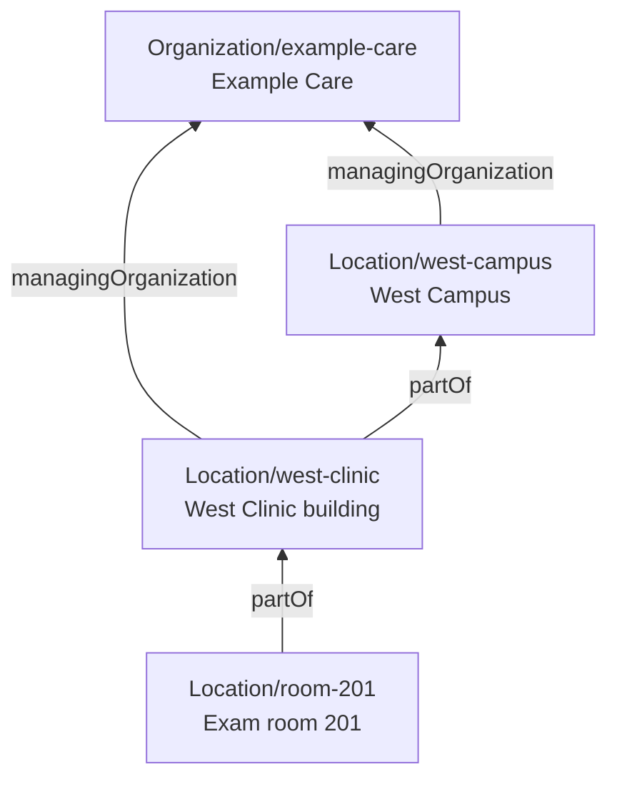

# Organizations and Locations

Use this guide to model organizations and the places they use across scheduling, referrals, clinical care, and billing. Connect facilities to the organizations and services that use them, and choose the appropriate reference for each workflow.

A clinic can be the facility selected during booking and reported on a claim, while a room within it is reserved and recorded on the Encounter. These references can point to the same Location when that is sufficient; add detail when the workflow needs it.

## Places, organizations, and services

| What you need to represent | Resource and relationship |
| :--- | :--- |
| A practice, business, or operational division | `Organization`; use `Organization.partOf` for an organizational hierarchy. |
| A clinic, campus, building, room, or bed | `Location`; use `Location.partOf` to connect a place to its containing Location. |
| The organization managing a place | `Location.managingOrganization` references the Organization responsible for its provisioning and upkeep. |
| A service offered at one or more places | `HealthcareService.location` references those Locations; `HealthcareService.providedBy` identifies the organization providing the service. |
| A provider's role at an organization or service | `PractitionerRole` connects the practitioner, organization, services, and locations relevant to that role. |

An additional clinic usually needs another Location. Add an Organization when the organizational distinction itself matters, such as a separately managed division, billing entity, or tenant. Multiple Locations can share one managing Organization. See [Modeling Provider Organizations](/docs/administration/provider-directory/provider-organizations) for the broader directory model.

Some integrations use **practice location** to mean an Organization. [Health Gorilla](/docs/integration/health-gorilla/multiple-locations) and [ScriptSure](/docs/integration/scriptsure/multiple-locations) model their practice locations this way. A clinic may need both an integration-specific Organization and a Location for scheduling, clinical care, or billing. Follow the integration's mapping; these records are not interchangeable or automatically synchronized.

Use `Organization.partOf` for organizational subdivisions. For relationships between distinct organizations, such as partnerships or network participation, use [OrganizationAffiliation](https://hl7.org/fhir/R4/organizationaffiliation.html). See [Modeling Provider Networks](/docs/administration/provider-directory/provider-networks) for insurance network relationships.

### Organizations and tenant boundaries

**Projects provide Medplum's primary data-isolation boundary. Organizations within a project are not necessarily strict PHI boundaries.** An Organization can represent a tenant, while selected patient data, including the Patient resource itself, can be shared across organizations by design.

Define that separation and sharing through [AccessPolicy and ProjectMembership](/docs/access/access-policies). Creating Organizations, assigning a Location's `managingOrganization`, or linking a child with `partOf` does not enforce access to related patient records.

In Medplum's standard patient-enrollment model, related clinical resources can inherit the Patient's tenant assignments. If the requirement is to share the Patient record while keeping clinical records separate, account for that inheritance in the access design. See [Multi-Tenant Access Control](/docs/access/multi-tenant-access-policy) and the [Access Control Decision Guide](/docs/decision-guides/access-control). For project isolation and explicitly configured sharing between projects, see [Projects](/docs/access/projects).

Organizations also represent payers, pharmacies, laboratories, and networks; creating one does not necessarily create a tenant. For example, practices can share a pharmacy directory while protecting each patient's pharmacy preference separately. See [Sharing pharmacy Organizations](/docs/integration/scriptsure/multiple-locations#sharing-pharmacy-organizations).

## Choose the location detail you need

For a simple outpatient practice, start with one clinic Location. Add rooms or beds when you need to reserve their capacity or document where care occurred. Add a campus or building level when your application needs to group or identify those places.

In this example, West Clinic occupies one building on a campus. The clinic is the service facility used for booking and billing, and room 201 has its own reservable calendar.

This is an example hierarchy, not a required structure. A standalone clinic does not need a campus parent, and a clinic occupying part of a building need not be modeled as the whole building. A Device remains a Device, with `Device.location` identifying where it is placed.

The hierarchy expresses relationships. It does not automatically make every query recursive or copy parent addresses into children.

## Describe each Location

| Field | What it tells consumers |
| :--- | :--- |
| `name`, `address` | The place's identity and address. Populate the fields required by the workflows using that Location. |
| `physicalType` | Physical form, such as a site, building, room, or bed. |
| `type` | Function or service setting. This is distinct from physical form and a billing place-of-service code. |
| `mode` | `instance` identifies a particular place; `kind` describes a class of places, such as a generic patient's home. Use instances for the specific places in the example. |
| `status` | Whether the record is active, suspended, or inactive. This does not represent individual reservations. |
| `partOf` | The containing Location. It references another Location, not an Organization. |
| `managingOrganization` | The organization responsible for the Location. This does not by itself identify the billing provider. |
| `identifier` | Business identifiers used to match the place across systems. Where a billing integration requires a service-facility NPI, record it using `http://hl7.org/fhir/sid/us-npi`. Not every Location has its own NPI. |
| `hoursOfOperation` | Opening hours. Medplum scheduling availability is configured separately through HealthcareService and Schedule scheduling parameters. |

These are [FHIR R4 Location fields](https://hl7.org/fhir/R4/location-definitions.html). Use each distinction for its intended purpose: a room's physical form, a clinic's function, and a claim's place-of-service classification answer different questions.

## Choose the reference for each workflow

| Workflow | Field | Example |
| :--- | :--- | :--- |
| Offer a visit type at the clinic | `HealthcareService.location` | West Clinic. |
| Associate a provider with the clinic | `PractitionerRole.location` | West Clinic, in the relevant role context. |
| Place a device in a room | `Device.location` | Room 201. |
| Identify who should receive a referral or perform an ordered service | `ServiceRequest.performer` | The receiving Organization, HealthcareService, or clinician. |
| Request a physical site for that service | `ServiceRequest.locationReference` | West Clinic. |
| Give the room a reservable calendar | `Schedule.actor` | Room 201. |
| Record the booking's service facility | `Appointment.supportingInformation`, using Medplum's facility marker | West Clinic. |
| Reserve the room for an appointment | `Appointment.participant.actor` and Slots linked to its Schedule | Room 201, included in the booking. |
| Record where the patient received care | `Encounter.location[].location` | Room 201, or the actual place if different. |
| Identify the facility for a claim | `Claim.facility` | West Clinic, when appropriate for the submission. |

The facility marker in the table is a **Medplum convention**, not a standard FHIR facility field. Use `toAppointmentSiteReference` to create the marked reference and `getAppointmentSite` to read it, both from `@medplum/core`. The marker is defined by `SchedulingSiteURI`.

A simple clinic visit may use the same Location for booking, care, and billing. For more detailed workflows, define the mapping explicitly. The appointment records the plan, the Encounter records the care, and the Claim identifies the facility appropriate to the billed service. The scheduling operations do not create those downstream records or copy location references into them.

For referrals and orders, distinguish who should perform the service from where it should happen. Selecting a receiving Organization does not select a physical site. See [Recipients and Referral Packages](/docs/careplans/referrals/recipients-and-packages#choose-the-recipient-model) for choosing the destination.

### Scheduling

Selecting a service facility does not reserve a room. Include the room's Schedule when finding and booking time if its capacity must be reserved. Availability is implicit: Medplum creates Slots for booked, held, or blocked time, rather than pre-creating free Slots. See [Defining Availability](/docs/scheduling/defining-availability).

Listing several Locations on a HealthcareService does not define different hours at each site. For site-specific availability, use separate HealthcareServices for the sites, with a shared practitioner Schedule and service-specific overrides where needed. See [Choosing the actor](/docs/scheduling/defining-availability#choosing-the-actor) for this pattern.

Configure the time zone used by each Schedule's availability. Scheduling uses time zone settings on the Schedule or HealthcareService, with the Schedule actor's time zone as a fallback. A time zone on a facility or its managing Organization is not automatically inherited by a practitioner's Schedule. See [Facility Time Zones](/docs/scheduling/timezones#facility-time-zones).

To close a facility's calendars, update the affected Schedules or block the unavailable time. Changing the parent Location's status or opening hours does not close those calendars automatically.

Facility assignments and licensure also answer different questions. A role referencing a licensed jurisdiction does not establish an assignment to a particular clinic. Use the [service-specific licensure model](/docs/scheduling/state-by-state-licensure) when needed, and enforce required eligibility checks in the application's controlled booking path.

The supplied React components have specific facility-selection and matching rules. Review those [component contracts](/docs/scheduling/react-components#service-facility-references) when adopting the model; the selectors do not enforce backend eligibility or data access. Choose how to use the UI in the [Scheduling Decision Guide](/docs/decision-guides/scheduling).

### Clinical care

Use `Encounter.location` at the level the clinical workflow needs. Its entries can include `status` and `period` to distinguish planned locations from actual presence and to record movement. The room originally reserved may differ from where care occurred.

`Encounter.serviceProvider` identifies the organization responsible for the encounter's services. It is separate from the physical location. See [FHIR R4 Encounter location](https://hl7.org/fhir/R4/encounter-definitions.html#Encounter.location) and the [Chart Data Model](/docs/charting/chart-data-model).

## Billing facility and place of service

`Claim.facility` identifies the Location where services were provided. A **place-of-service code** classifies the setting for billing. The facility, billing provider, and place-of-service classification are separate inputs.

For example, a visit delivered in room 201 may be billed under West Clinic. The claim-building workflow must choose the appropriate facility and supply its required name, address, and identifiers. The Candid and Stedi integrations read those details from the selected Location without inheriting them from its parent. Do not assume the first encounter location, the closest parent, or the Location's managing Organization is always the correct billing choice.

FHIR R4 allows a service line's `Claim.item.location[x]` to be a coded setting, an address, or a Location reference. Medplum's Candid and Stedi professional-claim integrations read place of service from `Claim.item.locationCodeableConcept`; they do not infer it from `Location.type` or `physicalType`. See [FHIR Claim definitions](https://hl7.org/fhir/R4/claim-definitions.html), [Candid facility mapping](/docs/integration/candid/claim-submission#location-service-facility), and [Stedi facility mapping](/docs/integration/stedi/claim-submission/professional-claims#service-facility) for the applicable requirements and fallback behavior.

## Telehealth

Keep the visit's delivery method separate from where its participants are located. A remote visit still has location information relevant to clinical care, eligibility, and billing.

FHIR R4 describes a virtual encounter using `Encounter.class` and, when useful, an `Encounter.location` reference to a generic setting such as the patient's home. Such a generic Location uses `mode = kind`; it describes the category, not the patient's current address. A specific place uses `mode = instance`. This is a supported model, not a requirement to create a new home Location for every patient or visit. See [FHIR R4 virtual encounters](https://hl7.org/fhir/R4/encounter-definitions.html#Encounter.location).

| Question | Workflow consideration |
| :--- | :--- |
| How will the visit happen? | Distinguish in-person, video, and phone visits and provide joining instructions where applicable. |
| Where is the patient during this visit? | Confirm the actual setting and jurisdiction when needed for the service, including address detail when the care workflow requires it. A mailing address alone does not confirm the patient's current location. |
| Where is the clinician working? | Capture this separately when required. Directory assignments and licensed jurisdictions do not establish the clinician's location during a particular visit. |
| What should billing report? | Derive the required place of service and facility information from the visit context and submission requirements. A virtual encounter class does not automatically determine either. |

For US professional claims, CMS distinguishes telehealth at home from telehealth elsewhere. Use the [CMS definitions](https://www.cms.gov/medicare/coding-billing/place-of-service-codes/code-sets) and the relevant payer requirements for that classification.

Choose how the application captures and confirms these facts, then maps them into clinical and billing records. FHIR's generic home Location does not replace those inputs, and a virtual visit does not require a fictitious physical clinic to satisfy a facility picker.
