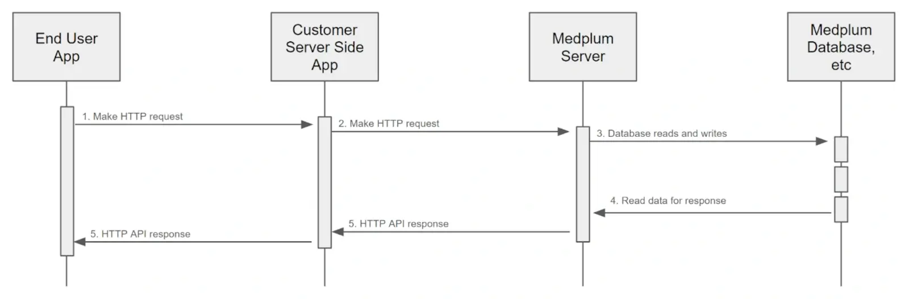

import ExampleCode from '!!raw-loader!@site/..//examples/src/auth/on-behalf-of.ts';
import MedplumCodeBlock from '@site/src/components/MedplumCodeBlock';

# On-Behalf-Of

On-Behalf-Of lets your backend authenticate as a privileged `ClientApplication` and supply a user's membership context for each Medplum request. Medplum applies the delegated membership's access policy and can record both the application and the user in resource metadata.

This is application authentication with user delegation. A backend using [server-held token exchange](/docs/auth/token-exchange#server-held-medplum-tokens) instead authenticates its Medplum requests with the user's exchanged token, without an On-Behalf-Of header.

## Overview

Consider this common Medplum architectural pattern:



Your backend authenticates the person using your application's login system, resolves the corresponding Medplum membership, and attaches that context to outgoing Medplum requests. The delegation header identifies the user context; it does not authenticate the person to your backend.

## How to Use

### Authenticate the application

Authenticate your backend as a `ClientApplication` with [Project Admin](/docs/access/admin#project-admin) rights. Follow [Client Credentials](/docs/auth/client-credentials) to obtain an application access token. On-Behalf-Of also supports Basic Authentication. Keep these application credentials on the trusted backend.

### Resolve and attach user context

Authenticate the incoming user request and resolve its Medplum membership using a mapping controlled by your backend. Include the `X-Medplum-On-Behalf-Of` header on each outgoing request. The value can be either:

1. A membership reference, `ProjectMembership/{id}`. This explicitly selects the membership stored in your backend's mapping.
2. A profile reference, such as `Patient/{id}` or `Practitioner/{id}`. Medplum looks up the corresponding `ProjectMembership` in the application's project.

For more information on `ProjectMemberships` and profile resources, see the [User Management Guide](/docs/user-management).

The `X-Medplum-On-Behalf-Of` header is only valid for the current request. It is not stored or persisted in any way.

### Handle missing or invalid context

Without the header, Medplum uses the application's own access. A valid header for a different user can delegate to that user. Reject requests with missing or inconsistent user context before calling Medplum, and do not forward an arbitrary delegation header supplied by the caller.

Treat a rejected delegation request as a failure; do not retry it without the header. Keep privileged application operations separate from handlers serving user requests.

## How it Works

When the Medplum Server receives a request with the `X-Medplum-On-Behalf-Of` header, it will:

1. Authenticate the `ClientApplication` as normal
2. Check for the `X-Medplum-On-Behalf-Of` header
3. If present, set up the Repository instance accordingly
   - Set `onBehalfOf` to the specified `ProjectMembership` ID
   - Use the `ProjectMembership` access policy
4. Proceed with the request as normal
5. Include the `onBehalfOf` value in the `meta.onBehalfOf` element of the response

## Example

Here is a curl example of using the `X-Medplum-On-Behalf-Of` header:

<MedplumCodeBlock language="bash" selectBlocks="curlExample">
  {ExampleCode}
</MedplumCodeBlock>

Here is the same example using the Medplum SDK:

<MedplumCodeBlock language="ts" selectBlocks="createResourceOnBehalfOf">
  {ExampleCode}
</MedplumCodeBlock>

For a client dedicated to one delegated membership, you can set the header at construction. Do not reuse that client for requests from other users or mutate a shared client's delegation context:

<MedplumCodeBlock language="ts" selectBlocks="defaultHeadersOnBehalfOf">
  {ExampleCode}
</MedplumCodeBlock>

Note the two extra HTTP request headers:

1. `X-Medplum: extended` - This is required to enable the extended Medplum API features, such as `meta.author` and `meta.onBehalfOf`.
2. `X-Medplum-On-Behalf-Of` - This is the `ProjectMembership` ID that the client is acting on behalf of.

Here is the resulting FHIR JSON:

```json
{
  "resourceType": "Patient",
  "id": "00000000-689b-4e20-a3c2-6f55108b432a",
  "meta": {
    "versionId": "00000000-b58b-47c8-9fc0-f85627d333c9",
    "lastUpdated": "2024-07-13T21:18:45.850Z",
    "author": {
      "reference": "ClientApplication/00000000-d361-46f0-adf4-f56da467dc08",
      "display": "My Client"
    },
    "onBehalfOf": {
      "reference": "Practitioner/00000000-9886-4b83-a25a-3b99563b8127",
      "display": "My Test User"
    }
  },
  "name": [{ "given": ["Homer"], "family": "Simpson" }]
}
```
